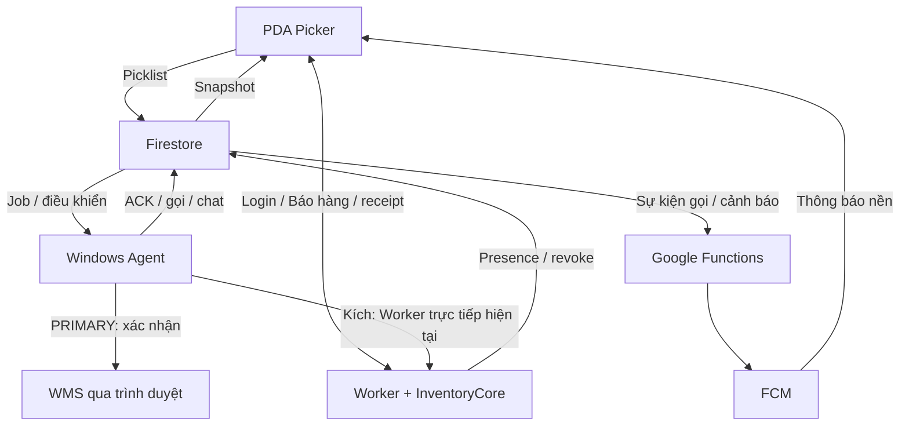

# D169 — Luồng Agent–PDA và thiết kế tự thích ứng khi đổi mạng

**Phân tích mở rộng / đề xuất chờ duyệt, 16/10/2026.** Không phải CODE READY hay triển khai. Main `7ec91a75`, working PR #606 `09073318`; bootstrap manifest và đầy đủ thứ tự authority được đọc lại. Toàn bộ 28 checks của HEAD cũ đã completed, không có failure; không suy từ CI thành field/usage PASS. Phân tích này bổ sung E015, không thay quyết định giữ critical Firestore hoặc tự duyệt migration.

## Kết luận thiết kế

Nâng Agent cần một bộ điều phối theo **vai trò + network epoch + khả năng endpoint + loại nghiệp vụ**, thay vì một công tắc duy nhất theo Wi-Fi của PRIMARY. PRIMARY độc quyền thao tác WMS; các Agent được cấp quyền khác vẫn có thể gửi chat, gọi Picker và kích phiên. Vì vậy PRIMARY ở PDA không đồng nghĩa các Agent Office được ngừng mọi kênh Firestore.

Đề nghị triển khai trước mô hình thích ứng trên carrier hiện có: Firestore Picklist/ACK và lệnh Picker; liveness RTDB hoặc Firestore được cả nhóm HA thống nhất; Worker trực tiếp khi route có thật; cầu Google có xác thực cho tác vụ server-only cần chạy từ Office; presence theo sự kiện, bỏ đường đọc/ghi trùng. Migration toàn bộ data-plane sang RTDB hoặc Worker WebSocket là phương án riêng phải đổi cả App/Service, chưa được chọn từ yêu cầu phân tích này.

## 1. Sơ đồ luồng đang tồn tại

Đường Kích Agent→Worker hiện không có fallback Office trong callsite được rà. Sơ đồ biểu diễn luồng source; không khẳng định mọi đường đều thông từ mọi mạng. RTDB hiện phục vụ HA, **không phải carrier Picklist đang dùng trên mạng thường**.

## 2. PDA gửi Picklist và nhận kết quả

### Luồng thực tế

1. Android `RelayPocClient.sendProbe` kiểm tra cửa sổ vận hành, phiên API và Firebase UID/session generation. Khi cần, refresh phiên và đăng nhập custom token đúng UID/generation.
2. Sinh UUID request, ghi một document `relay_poc_jobs/<request_id>` trạng thái PENDING, có suffix, danh tính Picker, generation, thời điểm client và server timestamp. Không truyền WMS cookie/password sang PDA.
3. Nếu create không rõ kết quả: đọc server, rồi retry **cùng request ID**. Không sinh request mới để chữa timeout và không overwrite ACK.
4. PRIMARY có pending-query gRPC listener; dữ liệu event được chuyển thẳng vào cùng pipeline nghiệp vụ. REST watchdog vẫn chạy khi cần. Hiện healthy: 10s khi có PDA, 30s khi idle; degraded dùng policy 1/2/3/15s theo trạng thái và budget. NEXT_A/NEXT_B không cùng đọc hàng đợi nghiệp vụ.
5. Agent gộp trùng request, xét tuổi job, xác minh PRIMARY/generation trước ingress. Một lô tối đa 15 request; prefix/suffix được giải nghĩa bằng WMS browser đang được người dùng đăng nhập. PRIMARY thiếu WMS có thể nhận/ghi lịch sử và trả lỗi có loại, không giả thành công.
6. Trước final action: claim guard theo Picklist đầy đủ, kiểm tra quyền PRIMARY/generation và WMS readiness. Chỉ chạy semantic browser UI; không mở WMS API mới. Kết quả không rõ không được suy thành confirmed từ việc dòng biến mất.
7. Agent commit một ACK terminal lên chính document job với kết quả/reason/operator/duration. Đây là write xác nhận nghiệp vụ, không phải FCM riêng cho mỗi thành công. Guard, role reads, daily summary, archive là các meter bổ trợ.
8. PDA nghe exact job document; nhận ACK rồi đóng listener. Nếu chưa nhận, sau vòng chờ có một server read cuối để khôi phục ACK bị lỡ. Android không tự xóa job sau khi nhận.

### Ranh giới thời gian cần giữ đúng

- Cửa sổ chờ ACK trong `executeProbe`: 20s **sau giai đoạn create**; create/auth/recovery có budget riêng, nên không gọi 20s là tổng tuyệt đối từ lúc bấm.
- Source có thông báo chờ chuyển dự phòng khoảng 10s, nhưng đây là text tiến trình, không phải bằng chứng takeover đã xảy ra.
- WMS mutation không bắt đầu nếu request age đã >=12s; query chỉ nhận pending còn trong cửa sổ khoảng 20s. Threshold nghi ngờ HA là 15s, chưa tính thời gian WMS probe/CAS.
- Vì 12s < 15s, **không thể hứa một request đang chờ sẽ luôn được standby hoàn thành trong cùng lượt chỉ nhờ failover 15s**. Cần ưu tiên chuyển kênh nhanh khi cùng PRIMARY còn khỏe; hoặc bàn riêng thay timeout/end-to-end contract trên App/Agent. Không kéo dài deadline hay tự tạo offline outbox trong bản tối ưu usage.
- Một máy đơn mất kết nối vật lý hoặc chưa đăng nhập WMS không thể được phần mềm bảo đảm realtime xuyên suốt. Giữ lỗi minh bạch và guard, không fake success. Hai Agent WMS-ready cho phép handoff bảo vệ khả dụng tốt hơn.

### Usage và đề xuất

Job có ít nhất một write gửi và một write terminal trong đường thành công không lỗi; guard và các reader/listener/query/roles/summary có chi phí riêng. 934 read operations của collection jobs trong ảnh **không đại diện toàn bộ chi phí Picklist**: empty watchdog query, confirm guards, coordination và rules có meter ở nơi khác hoặc không hiện như query thành công.

Giữ một ACK terminal và guard. Dedupe LISTEN/REST theo request/updateTime; không query mới chỉ vì vừa nhận một job đã có payload; bỏ no-op reconciliation, theo dõi stream freshness và resume. Watchdog chỉ giảm khi có bằng chứng fallback không làm xấu p95/p99 và deadline; không tắt chỉ vì trạng thái CONNECTED. Tận dụng batch hiện có cho chứng minh vai trò trên cùng lô mà không bỏ fence ngay trước mutation.

## 3. Agent gọi Picker về bàn CV

- Không bắt buộc người gửi là PRIMARY; tài khoản Agent phải có quyền ADMIN hoặc PICKPACK_ADMIN thật, giữ base_role.
- Agent đọc exact `picker_active_calls/<target_user_id>`; nếu đang ACTIVE và còn khóa thì không tạo lượt gọi chồng. Tạo call_id và PATCH có precondition updateTime/exists; khóa 60s, phân biệt CV Inventory/Pick Pack.
- Agent cập nhật call lock vào `agent_sync` để các Agent khác khóa nút/gìn giữ trạng thái người gửi. PDA nghe exact active-call của mình và hiển thị overlay.
- Function `pickerActiveCallCreated` đọc notification target và gửi FCM high-priority cùng call_id để hỗ trợ chạy nền. SDK/event và FCM phải dedupe cùng ID, không tạo hai cuộc gọi.
- Chỉ Agent gốc được kết thúc cuộc gọi. Resolve update trạng thái, đồng bộ fleet và Function gửi clear. Khóa chống gọi lặp vẫn giữ đến hết 60s. Hết thời gian/call resolved là sự kiện kết thúc; không có business ACK Picker→Agent cho thao tác này giống Picklist.
- Overlay loại gọi khác loại chat; không gộp nút xác nhận chat vào semantics kết thúc cuộc gọi. Không coi FCM accepted là PDA đã hiển thị hay Picker đã về bàn.

Chi phí gồm exact read + call write + shared-lock write, Functions/target read, listener delivery và resolve. Có thể gộp publication nhóm bằng batch có điều kiện nhưng không được trì hoãn khóa toàn fleet đến cuối lô dài. N document writes trong batch vẫn tính N writes; chỉ có thể tiết kiệm HTTP overhead và các shared-snapshot writes trùng.

## 4. Agent nhắn Picker và liên hệ nhóm

Chat hiện ghi hai nơi:

1. `picker_session_controls/<firebase_uid>`: chat_id, nội dung <=200 ký tự, TTL <=30 phút. PDA dùng listener session-control vốn có nên không cần một listener chat mới.
2. `picker_alerts/<alert_id>`: đường FCM tương thích. Function validate/window/presence/target rồi gửi; có thể ghi server_created/SENT/FAILED và đọc thêm. Đây là lý do 1 chat không đơn giản chỉ có 2 billed operations.

PDA bấm XÁC NHẬN chat chỉ đánh dấu đã đóng tại máy, không gửi read receipt lên server. FCM muộn cùng ID được bỏ. Vì vậy UI Agent không được tự hiển thị “Picker đã đọc”. Giữ FCM để chạy nền; tài liệu Android xác định high priority dành cho thông báo hiển thị kịp thời, không biến nó thành bus heartbeat.

Nhóm hiện lặp theo từng người nhận, kiểm tra UID/generation còn đúng, có giới hạn nhịp; nhóm N người có thể tạo 2N Agent chat writes trước chi phí Functions, không phải một tin giá cố định. Mỗi cuộc gọi nhóm vẫn có khóa riêng.

Tối ưu an toàn trước: bỏ `LoadLegacyAlerts` không được consumer dùng như E015; bỏ lặp cùng command ID, gộp shared UI publication có latency bound; giữ quyền người gửi/người nhận và kết quả từng mục.

Tối ưu sâu đề xuất: một nguồn chat canonical, server gửi FCM từ sự kiện chat_id thay đổi, cùng payload/ID hỗ trợ App cũ; sau kiểm chứng bỏ bản ghi legacy chỉ làm nhiệm vụ kích FCM. **Chưa có trigger này trong source hiện tại**; phải duyệt thay đổi Functions/resource, chống duplicate/out-of-order/retry, kiểm thử nền/Doze/đổi phiên. Không gắn trigger vô điều kiện vào mọi update session-control vì kick/chat/metadata có semantics khác nhau; không gọi Function cho heartbeat/agent_sync.

## 5. Kích Picker — cần xử lý quyền máy chủ và đường Office

Source hiện tại thực hiện đúng thứ tự quan trọng:

1. Agent `KickPickerUser` gửi POST `/api/agent/picker-session/revoke` trực tiếp tới Worker.
2. Core commit session generation/revoke bằng request_id idempotent; Worker xuất session-control revocation sau khi quyền máy chủ đã bị thu hồi, đóng realtime, vô hiệu target, cập nhật presence.
3. Agent chỉ bỏ dòng khỏi RAM và ghi shared kick sau server receipt thành công. PDA listener thấy generation bị revoke thì về đăng nhập và gửi log theo boundary hiện có.
4. Reconcile kicks cron 5 phút là recovery, không phải đường kích realtime.

**Lỗ hổng tương đương mạng đã xác minh ở source:** `TryD160WorkerRevokeOnce` chỉ gọi Worker, chưa dùng `D168NetworkRoute` hay gateway; Apps Script doPost hiện cũng chưa có action revoke. Nếu Office chặn Worker thì không có căn cứ nói chức năng kích sẽ hoạt động y hệt mạng thường. Không lấy một Firestore logout signal thay cho server revoke; làm vậy PDA vẫn có thể giữ business authority cũ.

Hai lựa chọn có thể duyệt:

| Cầu Office | Lợi ích | Giới hạn |
|---|---|---|
| Thêm action allowlist vào Agent Operations Gateway hiện có | Ít thay đổi, Google→Worker đã có mẫu xác thực, chỉ phát sinh khi bấm kích | Phụ thuộc UrlFetchApp tài khoản dùng chung, không giải quyết nguy cơ hết quota của Apps Script |
| Google event bridge tin cậy cho command hiếm | Agent Office gửi command qua Firestore; Google service gọi Worker/Core và trả receipt theo event, không polling | Phải thêm trigger/handler và resource được duyệt; thêm vài read/write/invocation mỗi command, cần test reachability/latency/duplicate |

**Đề nghị cho đích nâng cấp:** event bridge cho tác vụ server-only từ Office, tránh đưa HA, Picklist hoặc heartbeat qua Apps Script. Đây là resource/design mới **chưa được cấp quyền triển khai**, không mặc định tồn tại chỉ vì project Beta đã đăng ký. Phải reconcile scope/resource trước mutation. Nếu ưu tiên thay đổi tối thiểu, có thể chọn gateway allowlist làm bước tạm nhưng không tuyên bố độc lập quota.

Bridge phải xác thực danh tính người ghi bằng rules/auth context tin cậy, rồi Worker xác minh lại quyền, target và session policy. Không tin actor do client tự khai; không lưu bearer/refresh token trong command doc. Giữ cùng request_id khi retry, kết quả phân biệt authority committed / PDA signal sent / device observed. Worker không hoàn tất thì không báo kích thành công.

## 6. Picker online: hiện là phiên hợp lệ, không phải online vật lý

Core `onlinePickerProjectionData` chọn user ACTIVE + Android session + FCM device enabled khớp device. Source cố ý không xóa khi socket mất tạm thời. Điều đó bảo vệ phiên nhưng tên “đang hoạt động” dễ gây hiểu nhầm.

Luồng hiện tại có nhiều bản biểu diễn:

- Worker xuất `picker_presence_projection/current` và single-slot control job `relay_poc_jobs/picker_presence_current`.
- Agent trực tiếp listen presence; PRIMARY xử lý/ACK control job, có thể publish Pickers lần nữa vào `agent_sync`.
- Mọi Agent đăng nhập hiện listen cả agent_sync và direct presence, kể cả DEEP; DEEP còn có exact sync đọc 10 phút. PRIMARY reconciliation định kỳ 5 phút đọc nguồn rồi có CAS/no-op guard.
- Gửi Picklist có one-shot fallback thêm Picker thiếu danh sách; nếu đã có LOGIN/fallback cùng hoặc mới hơn generation thì không ghi lại mỗi Picklist. Logout/kick tombstone ngăn job hoặc snapshot chậm hồi sinh phiên cũ.
- Hash semantic đã bỏ timestamp last_seen để tránh registration không đổi biến thành heartbeat Firestore. Tính năng này đã có, không đề xuất lại như chưa tồn tại.

Đề nghị một authority danh sách phiên hợp lệ ở Core, một projection versioned cho Office. Sau nâng mọi Agent và chứng minh direct projection recovery/tombstone, có thể bỏ lặp mảng Picker trong agent_sync và control job ACK chỉ dùng để báo cùng một snapshot. Chưa xóa ngay vì App/Agent cũ, removal metadata, retry delivery và failover còn phụ thuộc các nhánh này.

Hiển thị bổ sung ba ý riêng:

| Thông tin | Nguồn | Ý nghĩa |
|---|---|---|
| Phiên còn hiệu lực | Core generation/session | Được phép làm việc; chỉ logout/kick/replacement mới thu hồi |
| Kết nối đang được server quan sát | Socket/transport đã xác thực của đúng phiên | Có kênh sống theo lần quan sát; không đồng nhất với phiên |
| Hoạt động gần nhất | Login/Picklist/API sự kiện thật | Dấu thời gian hoạt động, không phải heartbeat mới |

Tận dụng kênh PDA hiện có trước: Android WebSocket đang có pingInterval20s; không thêm heartbeat Firestore cho từng PDA. Core hiện chỉ cấp realtime ticket WEB/ANDROID, socket attachment chưa có session generation, nên việc dùng nó làm bằng chứng kết nối theo phiên cần nâng Service/contract, không chỉ đổi nhãn UI.

Chỉ phát presence khi ý nghĩa thay đổi, không mirror từng ping/timestamp sang Firestore. Mất socket tạm thời chỉ đổi trạng thái kết nối, không xóa phiên/kick. Không thể phát hiện một PDA tắt điện tức thì với độ trễ bằng 0 và không có tín hiệu sống; App nền/Doze/Force Stop cũng không suy từ FCM registration thành đang kết nối.

## 7. Bộ điều phối thích ứng trên Agent

### Quyết định theo từng lớp, không chỉ PRIMARY SSID

| Lớp | Mạng thường đã dùng được endpoint | Office theo cấu hình | Agent khác mạng cùng fleet |
|---|---|---|---|
| Picklist/ACK, guard | Firestore listener + watchdog | Như cũ qua Firestore | Chỉ PRIMARY xử lý; cùng authority/ID |
| Gọi/chat/clear | Firestore exact control + FCM | Như cũ | Bất kỳ Agent được cấp quyền gửi; không phụ thuộc PRIMARY đang ở mạng nào |
| Kích/server command | Worker trực tiếp | Google bridge đã được duyệt và chứng minh | Server revoke chung, không cấp quyền từ SSID |
| Danh sách Picker | Direct projection semantic theo event | Như cũ | Không relay nhiều bản giống nhau qua PRIMARY |
| Role/generation/WMS fence | Firestore | Firestore | Chung một authority |
| Liveness PRIMARY–standby | RTDB nếu mọi peer chịu trách nhiệm SLO dùng được | Firestore exact lease listener | Peer cần Office ⇒ chọn Firestore cho nhóm HA đó |
| SKU | Worker direct theo job/claim/WMS readiness | Chỉ network handoff được phép, lúc an toàn; không vòng SKU qua Script | Không ngắt Confirm đang chạy; state/DONE receipt chung |
| Log/Usage | Local-first và send boundary đã duyệt | Tương tự qua đường Google được phép | Không thêm gửi khi lỗi hoặc theo dõi provider liên tục |

### Chuyển mạng và kênh

1. Windows phát sự kiện network; đọc SSID/profile thực tế một lần, tạo network_epoch, hủy kết quả xử lý còn thuộc epoch cũ. Cấu hình Office/PDA tại máy; không public SSID/credential. Network event phải hoạt động khi Agent ở tray, không phụ thuộc UI Visible như refresh SSID hiện tại.
2. Office đã cấu hình: không thử RTDB/Worker bị cấm lặp mỗi vòng. NORMAL cho phép route tương ứng; UNKNOWN/Ethernet/VPN/multi-NIC giữ policy bảo thủ và chỉ đánh giá capability khi có tác vụ thật hoặc một lần sau thay đổi, single-flight/cache theo epoch.
3. Phân biệt auth401 (refresh có chặn nhịp), backend403 (RBAC/rules), proxy403/DNS/timeout (route) trước fallback. SSID không làm bằng chứng liveness, không mở firewall/rules hoặc đổi proxy trái phép.
4. So network/capability của PRIMARY và standby, không chỉ máy chính. Chọn heartbeat_transport + transport_epoch bằng coordination CAS; cùng PRIMARY đổi mạng chỉ đổi transport epoch, không tự tranh quyền hoặc tăng leader generation vô cớ.
5. Mở kênh mới, nhận snapshot/current generation và peer acknowledgement; trong cửa sổ chuyển tiếp giới hạn có thể giữ kênh cũ. Chỉ đóng kênh cũ khi peer đã nhận được tín hiệu mới đúng generation/epoch. Tránh chạy dual heartbeat suốt ca.
6. Việc đã được server nhận giữ nguyên request_id và kênh phản hồi đã cam kết; kết quả không rõ phải đọc receipt bằng cùng ID. Không phát lại WMS final-click, đổi command ID hay gửi qua cả hai nghiệp vụ như hai việc mới.
7. Nếu cùng PRIMARY giữ WMS và Firebase khỏe thì tiếp tục sau revalidation; nếu có Agent dự phòng WMS-ready phù hợp thì handoff theo authority. Không tự đổi PRIMARY chỉ vì một nhãn SSID, không nhận lệnh ngoài ca hay mutate khi freshness không chứng minh được.
8. Không nhầm tự chọn transport với tự kết nối Wi-Fi. D168 saved-profile/idle/consent và yêu cầu không ngắt Confirm vẫn nguyên; đọc SSID không tự cấp quyền chuyển mạng, bridge mạng công ty hoặc tạo profile.

Trong RTDB mode không cần FS heartbeat thường trực; Firestore mode chỉ standby cần tiếp quản nghe exact lease, không cho toàn bộ fleet đọc mỗi 10s. Khi primary/standby cần fallback, phải đồng ý chuyển mode chứ không đọc lease cũ rồi kết luận PRIMARY chết. Role/generation và guard tiếp tục bảo vệ mutation độc lập heartbeat.

## 8. Có nên chuyển cả Picklist sang RTDB/Worker khi PRIMARY vào mạng thường?

| Hướng | Tiết kiệm gì | Tác động/rủi ro | Đề nghị |
|---|---|---|---|
| Giữ nguyên và đo | Không | Giữ read/retry lãng phí | Baseline |
| Tối ưu event Firestore + adaptive HA + route server command | Cắt read legacy vô ích, lease polling, duplicate projection, retry/Functions writes dư | Chủ yếu Agent + Service/Functions chọn lọc; App cần cho receipt/contract thay đổi | **Chọn cho nâng cấp trước** |
| RTDB cho toàn bộ business khi PRIMARY thường, Firestore khi Office | Có thể đổi một phần document operations sang bytes RTDB | App hiện luôn ghi Firestore; phải thêm rule/RBAC PICKPACK_ADMIN, route epoch, request registry, một terminal authority, archive/guard và safety khi chuyển carrier | Chưa chọn; không làm bằng Agent-only |
| Worker/DO làm job hub, WebSocket cho PRIMARY thường + Firestore delivery bridge cho Office | Giảm một phần Firestore và dùng Core ledger/cursor | Agent chưa có AGENT realtime ticket/channel; cần App/Worker/Agent, SQL, durable online admission, Office bridge và tương thích | Là lựa chọn nghiên cứu riêng, phải đo tổng Worker/DO/Functions/Firestore |

Firestore query rỗng và changed-document listener đều có thể tính read; RTDB tính dung lượng/băng thông; WebSocket/DO cũng có request/duration/SQL/egress. Không coi socket hoặc FCM là miễn phí vô điều kiện, không cộng meter khác đơn vị. Nếu vẫn ghi mọi job vào cả Core và Firestore để giữ audit, việc đổi đường truyền có thể chỉ thêm usage mà không giảm Firestore.

Một mô hình adaptive data-plane đầy đủ cần **PDA biết route mới**; Agent không thể một mình làm cho vc110 đang hardcode Firestore tự gửi RTDB. Nếu route đổi khi request đang chạy, cần một request registry và trạng thái xác nhận chung, một khóa theo Picklist và ID thống nhất. Không có transaction atomic xuyên RTDB–Firestore–WMS UI; network partition phải giữ trạng thái uncertain/guard. Không hứa exactly-once external WMS chỉ từ broker.

Kết quả E015 cho thấy query bỏ kết quả và HA là cơ hội đo được. Chuyển toàn bộ nghiệp vụ chưa có provider baseline đủ và trái critical-lane hiện đã chốt nếu không được Owner duyệt lại. Vì vậy tối ưu trước trên hạ tầng đang hoạt động cho lợi ích/rủi ro tốt hơn; đây là quyết định kỹ thuật đề nghị, không hạn chế khả năng mở phương án lớn sau đo.

## 9. Gói nâng cấp và tác động

| Gói | Thành phần cần đổi | Kết quả / điều kiện |
|---|---|---|
| A: bỏ waste + quản lý mạng | Agent | Bỏ legacy read không dùng; lifecycle listener/readonly watchdog theo freshness; event-driven SSID/network epoch, auth/route circuit; giữ output nghiệp vụ |
| B: HA common transport | Agent + coordination metadata/rules theo scope | PDA–PDA RTDB, Office/mixed Firestore; mode handshake, WMS guard, không split-brain; cần đồng bộ Agent đủ capability |
| C: server command Office và fan-out | Agent + Worker/Core + Google Functions/rules/resource | Kích đúng quyền cả hai mạng; chat một nguồn + FCM, chống duplicate; reconcile scope trước thêm trigger |
| D: presence/receipt | Agent + Worker/Core; Android cho receipt/session binding; Web chỉ trình bày nếu cần | Phiên hợp lệ khác kết nối; bớt snapshot/control-job dư; sửa RECEIVED queue404, không giả ACK |
| E: đổi carrier toàn bộ nghiệp vụ | Agent + APK + Worker/Core/Google/rules/archive | Chưa khuyến nghị triển khai trong nâng cấp đầu; cần phê duyệt/migration riêng và đo tổng quota |

Gói A/B có thể chuẩn bị mà không đổi thao tác của Picker; không gọi chúng là hoàn tất C/D. C/D thay quyền/contract chung nên phải làm đồng bộ và giữ chức năng tương thích đến khi fleet thực sự nâng đủ. Không bật cơ chế mới chỉ vì EXE đã được publish. Các FIX code-only đang có ở PR606 không tự được phép phát hành bởi yêu cầu phân tích này.

## 10. Ma trận yêu cầu → contract → test → bằng chứng

| Yêu cầu | Contract / thành phần | Kiểm chứng bắt buộc |
|---|---|---|
| Nhận/gửi Picklist đúng một kết quả | Request UUID, same-ID create/retry, terminal document, guard, ingress/mutation fence | Listener + REST cùng thấy job, lost write/ACK response, concurrent same Picklist, 12s/20s boundaries, job cũ trở lại sau takeover |
| Đổi mạng không double confirm | network_epoch, transport_epoch riêng leader generation; WMS in-flight | Đổi trước final-click/giữa click–receipt/sau ACK; solo và hai WMS-ready; bảo toàn uncertain guard |
| Liveness tương đương hai mạng | Common-channel contract + CAS | Bốn cặp mạng, Office NEXT_B cần SLO, peer mất FS chỉ còn RTDB, PRIMARY khỏe/standby403, stream stale nhưng socket còn CONNECTED, token expiry/clock skew |
| Gọi/chat tương đồng | Per-target ID/session, originating Agent resolve, 60s lock, local chat dismiss, FCM dedupe | Hai Agent gọi cùng Picker, group burst, long text/PDA nhỏ, expired/late duplicate, foreground/background/Doze/process death, không phát receipt ngầm |
| Kích đúng quyền thật | Core revoke commit trước signal, idempotent command receipt | Office Worker-blocked, bridge timeout, authority committed nhưng response mất, target đổi phiên, operator bị thu quyền; không báo thành công chỉ vì PDA đóng overlay |
| Danh sách không ảo/hồi sinh | Core session authority + projection version/generation/removal tombstone | Logout/kick/session replacement, old snapshot/job chậm, transient disconnect giữ phiên, foreground socket không đại diện App background, failed publish/restart recovery |
| Ít read/write và pin | Local bounded counters + provider meters | Cùng ca/số thiết bị/Agent-hours/Picklists/calls/chats/kicks; Firestore read/write/rules/index, RTDB bytes/denies, Functions invocations, Worker CPU/DO rows và shared UrlFetch riêng |
| Không làm hỏng phần khác | Báo hàng Web/Reporter/ACK/SKU/ca/log/CI | 00:00/03:00/05:00/14:00/21:45, SKU INITIAL SOLO PRIMARY, network switch idle-only, signed update/version mismatch, archive trước cleanup, no Stable |

Thiết kế đạt khi throughput và p50/p95/p99 nhận request/terminal ACK/call/clear/kick không kém baseline tương đương, không lost/duplicate WMS mutation, không false ACK/revoke, pin/CPU không tăng và meter giảm được xác nhận. Chưa có kết quả thử vật lý hoặc % tiết kiệm toàn mô hình cho phương án mới. Rollout theo capability/feature flag, tương thích mixed version và rollback có mode boundary; không rollback bằng đọc lease cũ làm authority.

## Nguồn rà trực tiếp

`android/.../RelayPocClient.kt`, `PickerActiveCallWatcher.kt`, `StockMessagingService.kt`, `CriticalOverlayService.kt`, `NotificationSignalStore.kt`, `AndroidRealtimeClient.kt`, `MainActivity.kt`; `relay-agent/FirestoreConfirmationTransport.cs`, `D160ConfirmPipeline.cs`, `FirestoreConfirmationGuard.cs`, `FirestorePickerContact.cs`, `D119AgentFeatures.cs`, `D168GroupPickerContact.cs`, `D160Resilience.cs`, `FirestoreAgentSync.cs`, `FirestoreAgentLeaderCoordinator.cs`, `RtdbHaLiveness.cs`, `D168NetworkRoute.cs`, `Program.cs`; `service/src/firestore-projection.ts`, `notifications-core.ts`, `notification-api.ts`, `read-model-core.ts`, `core.ts`, `index.ts`; `functions/src/index.ts`; `firebase/*rules*`; `ops/apps-script/agent-log-gateway/Code.gs`.

Tài liệu chính thức đã kiểm tra: https://firebase.google.com/docs/firestore/pricing ; https://firebase.google.com/docs/database/usage/billing ; https://firebase.google.com/docs/cloud-messaging/android-message-priority ; https://developers.cloudflare.com/durable-objects/best-practices/websockets/ . Đo usage theo E015; lần phân tích này không giả là vừa có log/provider-window mới.

**Bước tiếp:** Owner xem và chốt phạm vi A–D hoặc lựa chọn carrier E trước code. Giữ PR606 Draft/unmerged và mọi deployment gate hiện tại; không tự thêm trigger/resource/đổi quyền dự án hoặc phát hành từ hồ sơ phân tích.
