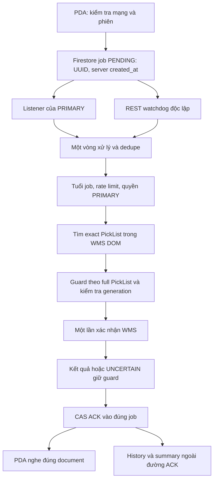

# D173-E099 — Rà soát Agent ↔ PDA: ổn định, nhanh và tránh xử lý lặp

Ngày: 29/10/2026. Trạng thái: **SOURCE AUDIT / PROPOSAL FOR OWNER REVIEW**. Chưa sửa code vận hành, chưa triển khai, chưa có FIELD/Owner PASS cho các đề xuất dưới đây.

## 1. Quyết định và phạm vi

E098 ghi nhận Owner đồng ý thiết kế E097 về Báo hàng để giữ làm backlog tối ưu khi cần. Đây là đồng ý hướng thiết kế, không phải lệnh thực thi. Báo cáo E097 cùng giả định, phương án có điều kiện, kiểm thử và rollback được giữ nguyên để tra cứu.

Yêu cầu mới là rà soát riêng **Agent ↔ PDA**. Owner cho biết usage phần này tương đối ổn; mục tiêu ưu tiên là đúng kết quả, ổn định, phản hồi nhanh, giảm tác vụ/retry/usage thừa. Không lấy giảm quota làm lý do tăng độ trễ hay giảm khả năng dự phòng.

- Audit source tại `main:15fe01f90466629ad6351cf32b72ba6f6a443b44`; branch làm việc là PR794. E098 được lưu và đọc lại tại `352e48dd50faa84bd6154ac7f396c3830dd8202e` trước khi kết luận E099.
- Đã đọc authority, scope/state/continuity, source Agent/Android/Rules/Functions và các mốc E088/E090/E093/E094/E096. Source hiện tại không đồng nghĩa toàn bộ thiết bị đã cài đúng phiên bản.
- Bao gồm: đăng nhập Firebase liên quan relay; tạo job; listener/REST; chọn PRIMARY/HA; WMS DOM; guard; ACK; chống spam; history/summary; Liên hệ Picker/chat/kích phiên; lifecycle và phục hồi mạng.
- D172 độc lập **PENDING/HOLD**, không sửa hoặc kiểm tra nghiệp vụ thật. Báo hàng, SKU, Usage UI, OTA chỉ được xem tại ranh giới phụ thuộc; không mở thêm việc triển khai.
- Không thực hiện WMS mutation, gọi thử giao dịch thật, sửa provider, cấp resource, thay Rules hay release Agent/APK.

**Kết luận:** giữ Firestore làm carrier và giữ mô hình PRIMARY/generation/guard hiện tại. Có các lỗi tiềm ẩn ở đường lỗi có thể sửa gọn, giá trị cao hơn việc đổi kiến trúc. Ưu tiên tách kết quả WMS khỏi lỗi giao ACK, giới hạn retry theo một ngân sách chung, làm rõ vòng đời session/listener và loại bỏ xung đột CAS/cache do chính client tạo ra. Không có bằng chứng định lượng để hứa phần trăm giảm usage hay latency.

## 2. Mô hình đang chạy theo source

Hai đường nhận job không phải hai chủ thể cùng bấm WMS: listener chỉ đẩy snapshot vào queue; transport duy nhất sở hữu business loop. REST watchdog chạy bất đồng bộ, có kiểm tra owner khi nhận kết quả. Các lớp chống lặp gồm request ID, canonicalization trong cycle, terminal RAM TTL 60 giây, full PickList grouping, guard Firestore và CAS ACK.

### 2.1. PDA gửi yêu cầu

`PickerController.submitRelayProbe` chặn double tap bằng `relayRequestInFlight`, chỉ nhận 3–20 chữ số và yêu cầu mạng validated. Không có chế độ xác nhận offline.

`RelayPocClient.sendProbe` kiểm tra lịch. Khi lịch local đóng, chỉ reconcile Worker/Firestore có gate 60 giây; không poll liên tục. Firebase session đang đúng UID và numeric generation được tái sử dụng qua `getIdToken(false)`; không phải mỗi lần bấm đều gọi Worker refresh.

Mỗi thao tác gửi chủ động tạo UUID mới. Job gồm identity/generation, `client_sent_at_ms` để chẩn đoán và `created_at=serverTimestamp` làm mốc nghiệp vụ. Nếu tạo job không rõ đã thành công hay chưa, client đọc đúng document rồi retry **cùng ID**. Không nhân job trong chính lần phục hồi đó. Rules chỉ cho Picker create PENDING, không cho sửa/ghi đè ACK.

Sau tạo, PDA nghe đúng job; kiểm tra request, Picker, generation, source, trạng thái và pending local writes. Cửa sổ chờ bình thường 20 giây; mốc 10 giây chỉ thông báo đang chờ, không giả vờ standby đã tiếp nhận. Chỉ recovery grant từ server đúng job/identity mới mở 35 giây. Ở ranh giới 20 giây có một exact server read để cứu ACK/grant; source đã tránh đọc lần hai khi không có recovery được xác minh.

Lưu ý: 20/35 giây là **cửa sổ logic**, chưa phải cam kết hard deadline toàn thao tác. Auth diễn ra trước `started`; các `Tasks.await` đọc/tạo có timeout riêng và có thể vượt mốc. Không nên ghi UI/SLA rằng mọi lỗi đều kết thúc chính xác ở giây 20.

### 2.2. Nhận việc và HA

| Thành phần | Hành vi nguồn hiện tại | Ý nghĩa |
|---|---|---|
| PRIMARY | gRPC PENDING + REST watchdog | Realtime chính, REST cứu khi stream lỗi/Office chặn |
| Listener khỏe, có PDA | Watchdog 10 giây | Không thay đổi trong đề xuất đầu |
| Listener khỏe, không PDA | Watchdog 30 giây | Giảm nền khi không có nhu cầu |
| Listener lỗi | HOT 1 giây; active 3 giây; inactive 15 giây; nhánh resilience 2 giây | Giữ khả năng nhận việc khi mất gRPC |
| NEXT_A/NEXT_B/DEEP | Không query hàng chờ nghiệp vụ | Tránh nhiều Agent cùng nhận/bấm |
| Common PRIMARY lease | Heartbeat 10 giây, stale threshold 15 giây | Firestore generation vẫn là authority |
| Internet HA | RTDB liveness là tín hiệu phụ | Không chuyển job/ACK sang RTDB |
| Office HA | Common Firestore lease và các fence | Không dùng WMS corporate proxy để bypass Firestore |
| Presence Agent | Heartbeat/read nền 10 phút, chỉ PRIMARY scan fleet | Đã bỏ mô hình N×N scan |

Tên hằng và source mới quyết định cadence; các đoạn D097/D117 cũ trong tài liệu không được dùng để thay thế source hiện tại. Không suy diễn từ spinner 10 giây thành failover 10 giây.

Job quá 35 giây bị bỏ; job quá 20 giây chỉ có thể được xử lý trong recovery hợp lệ. Kiểm tra PRIMARY tại ingress không thay cho kiểm tra trước mutation. Recovery grant giữ job PENDING, có updateTime và generation, không phải ACK thành công.

### 2.3. Pipeline WMS

1. Gom tối đa 15 request, dedupe theo ID; lấy history/context từ RAM.
2. Check rate limit trước tra cứu. Khi WMS chưa sẵn sàng và còn standby có thể cứu, giữ PENDING; khi không có standby mới trả trạng thái chưa sẵn sàng thích hợp.
3. `SearchMany` một lần cho nhóm suffix, phân loại không có dữ liệu/không tìm thấy/mơ hồ/row bị đổi/đã xác nhận/có thể chọn.
4. Nhóm sẵn sàng được xử lý trước; kết quả sẵn có được phát ACK sớm. Nhóm checkbox chậm có tối đa một đợt reload/recovery dùng chung và còn bị giới hạn tuổi request.
5. Gom nhiều request cùng full PickList thành một target. Acquire guard SHA256(full PickList), retention 30 ngày; xác minh PRIMARY generation trước `ConfirmManyExact`.
6. Browser kiểm tra đúng row/checkbox/dialog, chặn foreign selection, chỉ bấm final khi đúng điều kiện. Không gọi API WMS bằng session/token thu thập từ browser.
7. Đã có E093: **chỉ một exact PickList**, sau final click chưa rõ kết quả được reload/đọc lại có giới hạn; chỉ nhận `ALREADY_CONFIRMED` khi có bằng chứng dương cùng row (checkbox disabled và action lấy lại hàng). Không suy ra thành công từ row mất tích; không suy ra toàn batch từ một row.
8. Sau final click chưa rõ kết quả vẫn giữ guard, không bấm lại. Chỉ lỗi chắc chắn xảy ra trước final click mới có thể release guard.

### 2.4. ACK và điều khiển phụ

ACK commit hiện chỉ ghi job, có updateTime CAS; không kèm daily counter write trên đường nhanh. Summary dùng aggregate checkpoint khi đủ 50 ACK hoặc 5 phút, retry tối thiểu 60 giây; rebuild từ ACK truth sau đổi generation. History/summary không phải bằng chứng WMS độc lập.

Picker presence đã là projection gọn; Agent sync dùng exact document/listener, RAM snapshot, CAS và skip khi không đổi. Call specialist dùng một active-call document/Picker, lock 60 giây và CAS, không phải tạo một alert document vô hạn cho mỗi thao tác hiện đại. PDA nhận call/chat bằng Firestore và FCM để hỗ trợ nền; overlay đã dedupe theo ID khi đang hiện/đang queue. Kích phiên có generation control, không dựa riêng vào việc đóng UI.

## 3. Những cơ chế nên giữ nguyên

| Cơ chế | Vì sao không nên cắt để tiết kiệm |
|---|---|
| gRPC + REST dự phòng độc lập | Stream có thể không hoạt động trong Office; REST là lớp chịu lỗi, không mặc nhiên là request thừa |
| Một business owner, guard và CAS | WMS và Firestore không có transaction chung; đây là bảo vệ trước double confirm |
| Fence quyền tại ingress và trước mutation | Lease/generation có thể đổi giữa hai bước |
| Same-ID recovery khi create/ACK không chắc chắn | Tránh job mới và tránh bấm lại sau mạng lỗi |
| Recovery 35 giây chỉ khi có server proof | Không kéo dài tự động mọi job/không nhận việc đã hết hạn |
| Giữ guard sau final click uncertain | Giải phóng mù có thể gây mutation trùng |
| Tách ready/deferred và ACK sớm | Request dễ không phải đợi toàn bộ nhánh checkbox chậm |
| Summary checkpoint, projection, skip no-change | Đã giảm writes/reads; không thêm counter transaction mỗi ACK |
| Đóng overlay tại máy không tạo business ACK | Không làm sai trạng thái nghiệp vụ khi người dùng chỉ đóng màn hình |

Không gọi các bảo vệ trên là “rác” chỉ vì có nhiều lớp. Cần cắt chỗ một tầng lỗi kéo theo tầng khác lặp lại công việc đã xong.

## 4. Danh sách phát hiện và thứ tự ưu tiên

Mức **P1**: ảnh hưởng tính đúng hoặc phục hồi, nên xử lý trong đợt đầu sau Owner duyệt. **P2**: giảm độ trễ/việc lặp và làm hành vi dễ dự đoán. **P3**: chỉ cân nhắc sau số đo. “Xác nhận source” nghĩa là cấu trúc code có thật; chưa chứng minh tình huống đó đã xảy ra trên máy Owner.

| ID | Ưu tiên | Phát hiện | Lợi ích chính | Usage dự kiến |
|---|---|---|---|---|
| AP01 | P1 | Exception ACK sớm làm mất business outcomes | Không báo lỗi sai sau WMS thành công | Giảm xử lý lại; chưa định lượng |
| AP02 | P1 | Active-batch cleanup thiếu finally | Không kẹt trạng thái bận sau lỗi ACK | RAM, không thêm cloud |
| AP03 | P1 | ACK verify chỉ trả bool ACK | History/count dùng đúng kết quả đã thắng CAS | Có thể dùng lại read hiện có |
| AP04 | P1 | Retry nhiều tầng không có deadline chung | Giảm chờ dài và chặn hàng sau | Giảm attempt khi outage |
| AP05 | P1/P2 | Rate cache tự mất updateTime, invalidation dư, khác generation | Ít CAS conflict, đúng chống spam sau HA | Bớt GET/PATCH thất bại |
| AP06 | P1 | Android listener terminal error chỉ log, handle còn non-null | Call/chat/kick được tái gắn đúng | Chỉ reconnect khi cần |
| AP07 | P1 | Auth kiểm tra generation không đồng nhất | Tránh dùng phiên cũ/retry vô ích | Tái sử dụng phiên hợp lệ |
| AP08 | P1 | Callback/thread sống qua destroy/logout | Không cập nhật nhầm màn hình/phiên | Bớt wait/recovery thừa |
| AP09 | P1 | Khoảng chờ sau tuổi/fence trước final click | Chặn mutation muộn hoặc sau chuyển quyền | Ít việc quá hạn |
| AP10 | P1 điều kiện | Coordinator gộp lease với maintenance I/O | Tránh false failover khi read nền chậm | Không cần tăng heartbeat |
| AP11 | P2 | WMS health check thất bại có thể chạy liên tiếp | Tránh reload 12 giây lặp khi đang lỗi | Chủ yếu WMS/local |
| AP12 | P2 | Request già chi phối cả nhóm/batch | Request mới không bị loại oan | Ít user gửi lại |
| AP13 | P2 | Guard proof chưa đồng nhất ALREADY_CONFIRMED | Hành vi nhất quán sau restart | Không cần poll thêm |
| AP14 | P1/P2 | FCM call muộn/lặp có thể làm sống lại call hết hạn/đã resolve | Không hiện cảnh báo cũ | Ưu tiên dedupe tại máy |
| AP15 | P2 | Backoff REST dùng mốc success, lỗi cứng vẫn lặp | Tránh retry cùng lỗi vô ích | Giảm attempt lỗi |
| AP16 | P2 | Role/network epoch và vòng đời stream/queue | Bỏ kết quả cũ đúng session | Ít reconnect/replay |
| AP17 | P2 | Thời gian chẩn đoán dựa clock PDA; age/lease dựa clock PC | Chẩn đoán đúng, an toàn khi lệch giờ | Không thêm timer cloud |
| AP18 | P3 | REST KeepAlive=false; guard network nối tiếp | Tiềm năng giảm handshake/burst latency | Không giảm số document write |

### AP01 — Tách kết quả nghiệp vụ khỏi lỗi giao ACK

**Source xác nhận:** `FirestoreConfirmationTransport.ProcessBatch` tạo `earlyTerminal`; delegate gọi `TryCompleteBusinessAck` không bắt exception. `D160ConfirmPipeline.EmitD160TerminalOutcomes` gọi delegate trực tiếp. `Program.ProcessFirestoreConfirmations` chỉ có finally giảm counter, không cách ly exception ACK. Khi `TryAck` hết retry và throw, exception thoát khỏi pipeline; catch bên transport tạo **dictionary outcomes rỗng**. Vòng final ACK dùng `CONFIRM_ERROR` cho request không có outcome.

Ví dụ cần kiểm thử: WMS đã xác nhận A; B còn deferred. ACK A lỗi mạng → callback throw → pipeline thoát trước xử lý B/Finalize → transport mất bộ kết quả A/B → có thể ghi `CONFIRM_ERROR` khi mạng hồi phục. Guard vẫn bảo vệ khỏi bấm lại, nhưng không sửa được thông báo kết quả sai và batch bị gián đoạn.

**Đề xuất:** kết quả business được chốt theo request trước khi giao cho ACK. Callback chuyển thành giao nhận outcome không được throw vào business pipeline; ACK failure chỉ đổi delivery state. Giữ outcome gốc để retry ACK đúng job, không chạy lại WMS. Kết quả chưa biết phải tiếp tục là unknown/uncertain theo contract, không nâng thành success và không hạ kết quả đã biết chỉ vì gửi thất bại.

Đợt nhỏ ưu tiên RAM theo session/generation và một ACK dispatcher có giới hạn. Sau process crash, phải quay về guard/canonical job/WMS read-only proof hiện có; RAM không tạo bảo đảm durable. Nếu muốn chống mất business outcome qua crash, cần thiết kế online receipt ghi sau bằng chứng WMS vào resource hiện có, Rules/retention/reconciliation riêng và Owner duyệt. Đây không phải offline outbox và không được tự thêm mutation offline.

Không giữ early ACK bằng cách chặn WMS loop hàng chục giây cho mỗi network retry. Có thể giao ACK song song hữu hạn theo request (đề xuất ban đầu tối đa 2, cần đo); WMS mutation vẫn một owner tuần tự. Không fire-and-forget vô hạn, không ACK success trước WMS.

### AP02 — Cleanup active batch theo finally và operation identity

`_currentBatchWorks.Clear()` nằm ở cuối đường bình thường của `ProcessBatch`; final ACK throw có thể đi vòng ra ngoài trước cleanup. `HasActiveBatch` được dùng bởi gate chuyển route/network trong `Program`, nên trạng thái còn sót có thể khiến hệ thống tưởng vẫn có batch.

Đưa cleanup vào finally thuộc operation ID; không để task batch cũ xóa context của batch mới. Context dùng ACK/history phải thuộc từng outcome, không phụ thuộc một dictionary “current” có thể đổi trước khi ACK retry. Test phải inject exception ở early ACK, final ACK và callback lịch sử; sau lỗi gate trở về đúng trạng thái mà vẫn giữ receipt cần giao.

### AP03 — Dùng canonical ACK đã thắng CAS

`AckAlreadyVisible` hiện đọc đúng job nhưng chỉ kiểm `status == ACK`, rồi caller tiếp tục ghi audit/metrics theo **outcome local**. Khi Agent khác đã ACK kết quả khác, xác minh này chứng minh “job đã terminal”, không chứng minh “outcome local đã được ghi”.

Giữ hành vi không ghi đè winner. Trả về canonical ACK object; so request/Picker/source và fields bằng chứng liên quan; mọi history/count/recovered audit lấy winner truth. Phân biệt `MY_ACK_COMMITTED`, `SAME_OUTCOME_ALREADY_DURABLE`, `OTHER_TERMINAL_WON`, `NOT_VISIBLE`. Không retry business vì thua CAS. Tái dùng GET hiện có, không thêm GET cho mọi happy ACK.

### AP04 — Một deadline và một chủ thể quyết định retry

`TryAck`: tối đa 3 commit attempt. Mỗi lỗi lại `AckAlreadyVisible`; GET verify dùng transport safe-read mặc định tối đa 3 attempt, timeout 12 giây/attempt. Chỉ riêng cách nhân tầng đã có thể tạo tới 3 commit attempt + 9 GET attempt trong một chuỗi lỗi, chưa kể bước trước đó; thời gian thực phụ thuộc loại lỗi và không được tính như mọi request đều chờ đủ timeout. PDA cũng có timeout riêng cho auth/create/recovery/read.

Đề xuất operation context dùng monotonic deadline, truyền remaining budget vào HTTP/browser/ACK. Retry owner ở tầng nghiệp vụ, transport chỉ thực hiện attempt theo policy đã cấp. Phân loại network/timeout/429/5xx, credential expiry, permission revoked, conflict, invalid data. 401 có tối đa một forced refresh single-flight theo session; 403 Rules/session revoked không được lặp refresh vô hạn. Tôn trọng Retry-After khi áp dụng và jitter ở background reconnect.

Hết cửa sổ PDA không có nghĩa được quên ACK của WMS đã thành công. Tách **deadline bắt đầu mutation**, **thời gian UI chờ**, **thời gian reconcile outcome đã có**. Sau khi cửa sổ mutation đóng chỉ giao/đọc lại kết quả, tuyệt đối không tạo lần bấm WMS mới. Giới hạn ACK backlog/tuổi, lưu failure rõ ràng để hỗ trợ; không âm thầm bỏ outcome hoặc retry vô hạn. Giữ một authoritative verify khi commit không chắc chắn, không cắt mù bước đó để giảm usage.

### AP05 — Rate limiter: ba chỗ cụ thể có thể sửa gọn

1. Sau `RecordNotFound` PATCH thành công, cache được ghi `Exists=true, UpdateTime=""`. `WriteConditional` sau đó chỉ dùng updateTime nếu có; thiếu thì chọn `exists=false`. Vì document đã tồn tại, lần NOT_FOUND tiếp theo có thể tự tạo 409/412, force GET rồi PATCH lại. Giữ updateTime trả về từ PATCH sẽ loại được conflict do chính client gây ra.
2. `ClearFound` luôn `Invalidate` trước cả khi `shouldDelete=false`. Trường hợp Picker liên tục nhập đúng và không có strike, lookup sau lại GET trạng thái rỗng. Giữ negative cache có TTL, scope theo generation/session và invalidation khi biết có mutation. Không cache rỗng vô thời hạn qua HA.
3. Cache chỉ keyed theo Picker UID, không có TTL/generation; `ClearCache` có định nghĩa nhưng không thấy callsite trong Agent. Agent cũ có thể quay lại PRIMARY với lock cache từ generation cũ. Check locked có thể trả luôn mà chưa gặp CAS để refresh. Invalidate cache khi đổi PRIMARY/session; finite TTL và authoritative read khi cần, không bỏ chống spam. `ClearFound` DELETE hiện không CAS: nên dùng updateTime để không xóa strike vừa được Agent khác cập nhật; conflict cần reconcile theo thứ tự sự kiện nghiệp vụ.

Hai tối ưu đầu giảm đọc/thử ghi thừa; tối ưu thứ ba có thể tăng một ít read lúc HA nhưng làm kết quả chính xác hơn. Không thay thresholds chống spam (3 lần trong 60 giây, các cấp lock hiện có). Test cả duplicate request, nhiều Picker, hai generation và 24 giờ reset escalation.

### AP06 — Listener Android lỗi terminal không tự sống lại chỉ vì handle còn tồn tại

Trong `PickerActiveCallWatcher`, hai callback error chỉ log “reconnecting” rồi return. `callRegistration`/`sessionRegistration` vẫn non-null; `reconcile` dựa vào non-null + identity để quyết định có start lại hay không. Firebase mô tả listener sau terminal error không nhận thêm event; khác với mất mạng tạm thời SDK có thể tự phục hồi.

Đề xuất theo dõi state `starting/live/failed/stopped`, đánh dấu failed/null đúng registration khi error terminal. Reattach có backoff và auth repair một lần, chỉ khi session còn hiện hành; không tạo timer đọc call/chat riêng. Với ACK listener, permission/session error terminal nên báo đúng nguyên nhân và đánh thức waiter để xử lý bounded server reconciliation, thay vì chỉ giữ spinner đến hết timeout. Không coi một network disconnect bình thường là lý do hủy SDK listener rồi gắn lại liên tục.

### AP07 — Một chuẩn Firebase identity, một refresh đang chạy

`RelayPocClient` kiểm numeric generation trên đường auth sửa lần đầu; nhánh catch refresh/sign-in lần hai chỉ kiểm UID. `PickerActiveCallWatcher.start` reuse currentUser cùng UID mà chưa kiểm generation claim; callback sign-in chỉ chống khác user/UID, chưa gắn operation epoch/generation. Cùng UID đăng nhập phiên mới vẫn là phiên khác về quyền.

Dùng chung validation UID + numeric generation + app session identity trước attach/create; kiểm đầy đủ sau mọi sign-in branch. Tổ chức single-flight auth refresh giữa relay và active-call watcher, scope theo session; callback cũ không được signOut/attach phiên mới. Không refresh cho mỗi lần confirm nếu token đang phù hợp. Backend Rules/revocation vẫn quyết định quyền; local parse claim không thay kiểm chứng server.

### AP08 — Hủy chờ và chặn callback UI theo vòng đời

`PickerController` khởi tạo raw Thread cho relay; `destroy` chỉ gọi `RelayPocClient.close`, hàm này remove listener nhưng không signal waiter/cancel thread. Thread có thể tiếp tục timeout, exact read và `runOnUiThread` vào controller đã bỏ. Callback progress cũng chưa có relay operation epoch/session fence tương ứng.

Đề xuất request handle/cancellation theo controller + session generation. Destroy/logout ngăn progress/result render và ngăn bắt đầu read/retry mới; wake waiter ngay. `finally` remove đúng listener, không remove registration thuộc request mới. Lifecycle transition không được tự tạo UUID mới hay tự resend. Đóng màn hình không thể hoàn tác WMS đã bấm hoặc chắc chắn hủy Firestore SDK write đang bay; cần giữ tham chiếu request để reconcile đúng identity khi người dùng quay lại. Mọi phục hồi online phải giữ fence tuổi request hiện có.

### AP09 — Kiểm tra lại trước điểm không thể hoàn tác

Tuổi được check trước acquire guard; nhiều guard đọc/ghi nối tiếp và role verification có thể tốn thời gian. `ConfirmManyExact` còn đợi browser `_gate`, kiểm trang, có nhánh pre-final reload tối đa 5 giây + settle và đợi dialog. Không có callback quyền/tuổi sống đi xuyên toàn bộ đến final dialog click. Source có rủi ro khoảng trống thời gian, chưa phải bằng chứng đã xác nhận muộn thực tế.

Đề xuất truyền deadline/operation generation vào browser, kiểm sau khi giành browser gate và ngay trước irreversible click. Kiểm role/lease bằng proof hiện hành phù hợp; nếu cần fresh authoritative read thì làm trước bước chọn/click để giữ UX và budget, kèm local invalidation khi generation đổi. Không hứa tính atomic giữa Firestore và website WMS. Khi generation đổi sau final click: giữ guard, reconcile outcome cũ, không để PRIMARY mới bấm lại. Không hủy task sau click rồi mô tả như chưa làm gì.

### AP10 — Lease heartbeat không bị chặn bởi maintenance chậm

Coordinator loop vừa duy trì role/lease vừa presence, owner-consent REST fallback và scan fleet. Những call này có timeout/retry riêng và xảy ra nối tiếp trong một loop. Heartbeat mục tiêu 10 giây, stale 15 giây nên maintenance chậm có thể ăn hết khoảng dự phòng; điều này cần đo bằng log nhịp lease, chưa chứng minh false failover hiện tại.

Tách maintenance khỏi critical heartbeat hoặc dùng scheduler ưu tiên theo deadline, mỗi loại chỉ một task đang chạy; maintenance result phải kiểm generation trước apply. Không cho hai loop cạnh tranh quyền ghi lease/takeover. Đo lease-success gap, maintenance duration và takeover reason trước; không tăng heartbeat tần suất chỉ để che block. RTDB hỏng vẫn phải có common lease; không bỏ liveness proof hoặc dùng lỗi read làm bằng chứng PRIMARY đã chết.

### AP11 — WMS idle health check cần backoff sau thất bại

`TickD157SessionHealth` PRIMARY dùng `_d157LastWmsProofUtc >=60 phút` để đến hạn. Khi check thất bại, `_d157LastSessionValidationUtc` có cập nhật nhưng `_d157LastWmsProofUtc` không đổi; PRIMARY due không dùng last-attempt. Sau task kết thúc và nếu các điều kiện ready/idle vẫn đúng, UI tick có thể xếp một lần reload nữa ngay. Flag running chỉ ngăn chạy đồng thời, không tạo cooldown sau failure.

Tách lastAttempt/lastSuccess/nextAllowed. Failure backoff có giới hạn; reset khi có WMS proof thật hoặc operator action phù hợp. Check lại cả automatic confirm running/active batch trước health reload (source hiện check manual/readiness/migration/takeover). Giữ idle health cadence 60 phút/2 giờ, không thêm probe liên tục. Nếu readiness đã chuyển false, loop hiện có thể tự dừng; vì vậy số lần lặp thực tế cần chứng minh, không khẳng định mọi failure đều gây storm.

### AP12 — Không để một request già loại các request còn thời gian

`D160MutateReady` dùng `works.Any(!D160CanStartMutation)` cho group cùng full PL; một work hết thời gian khiến cả group nhận expired. Deferred recovery dùng max age của nhóm, nên một work già có thể chặn reload dành cho các work mới. Nếu mixed ordinary/recovery, budget wave còn phụ thuộc `Any(RecoveryAuthorized)` trong khi từng request có quyền khác nhau.

Lọc eligible từng request trước grouping; giữ request quá hạn ở terminal riêng. Group phần còn lại theo exact PL, chọn đại diện hợp lệ và budget theo request được phép, không cho request thường mượn recovery của request khác. Tối đa một WMS mutation cho cùng PL; cùng một bằng chứng terminal có thể phục vụ các request được phép theo contract. Test tuổi sát 6/6,5/12/20/29/35 giây và case vừa qua tuổi trong lúc acquire guard. Không kéo dài toàn batch để “cứu” một phần tử.

### AP13 — Đồng nhất guard proof và quản lý RAM hữu hạn

Sau E093 có thể tạo ACK `ALREADY_CONFIRMED` và gọi `MarkLocalConfirmed`. Nhưng `OriginalJobProvesConfirmed` của guard chỉ nhận `CONFIRMED`. Sau restart/Agent khác, cùng receipt có thể không được xem giống RAM trước restart. Nhánh DOM positive proof có thể đã trả ALREADY sớm nên không phải mọi request lặp đều gặp lỗi này; cần fixture đúng đường guard.

Đề xuất shared validator cho terminal success, bắt buộc đúng original job/full PL/guard và loại bằng chứng được chấp nhận. Không mở rộng thành “mọi ALREADY đều đủ” nếu thiếu evidence. Guard release pre-final thêm owner/updateTime precondition; không xóa guard của operation khác. `_locallyConfirmed` hiện HashSet không TTL/size; đổi cache có retention/generation/size phù hợp, eviction chỉ mất fast path rồi đọc lại durable guard, không tạo quyền bấm lại. Không rút retention 30 ngày để giảm usage.

### AP14 — Call/chat: giải quyết event cũ, không chỉ duplicate đang hiện

Functions đã so before/after status/call ID để tránh push khi ghi lại cùng call không đổi. Overlay đã dedupe active/queued theo ID; chat có dismissed store. Tuy nhiên:

- `pickerActiveCallCreated` dùng dữ liệu event snapshot. Nếu `lock_until_ms` đã qua, payload lại đặt `expires_at_ms=Date.now()+60s`; một invocation muộn có thể kéo dài lệnh cũ.
- `StockMessagingService` nhận resolved chỉ clear overlay, chưa ghi tombstone của call ID. ACTIVE push đến sau RESOLVED có thể enqueue lại; overlay active/queue dedupe không chặn ID đã clear.
- Call/chat push chưa có đủ target session/generation để cùng kiểm identity như job ACK; trường hợp token còn trỏ thiết bị đã đổi user cần audit recipient fence. Không kết luận đã lộ dữ liệu thực tế.

Đề xuất giữ expiry gốc, drop expired tại Function và PDA; không hồi sinh bằng TTL mới. Lưu resolved/dismissed tombstone hữu hạn theo recipient/session/call ID + version; RESOLVED không được bị ACTIVE cũ đảo lại. Thêm target identity/generation theo mô hình recipient chính thức, tương thích client cũ. Firestore snapshot và FCM cùng đi qua một reducer. Chỉ gửi/show khi thay đổi có ý nghĩa, không ghi cloud receipt mỗi lần overlay redraw. Nếu tombstone chưa tồn tại sau cài mới thì dùng exact authoritative reconciliation theo sự kiện bất thường, không poll liên tục.

Firestore triggers không đảm bảo thứ tự hoặc exactly-once. Server ledger chống trùng cho mọi FCM có thể tăng writes và vẫn không transaction được với FCM send; chưa nên thêm mặc định. Dedupe tại client + expiry/version thường là bước đầu nhỏ hơn. Không xóa Firestore listener chỉ vì đã có FCM, và không bỏ FCM wake cho app nền chỉ vì đã có listener.

### AP15 — Backoff cho lỗi cứng, giữ nguyên đường cứu realtime

`_lastRestPendingQueryMs` chỉ cập nhật khi query thành công. Sau failure, attempt tiếp có thể lại due ngay khi vòng transport/inner retry xong. Đây không phải hot-path read thừa khi hệ thống khỏe; vấn đề nằm ở outage/auth/rules lỗi kéo dài.

Ghi riêng attempt/success/nextAllowed/error class; một watchdog task đang chạy như hiện tại. Lỗi permission/schema cần park đến auth/config/network change đúng loại, kèm health rõ ràng; transient dùng backoff có trần và wake khi có request/network recovery. Nếu gRPC cũng mất và đang có PDA, policy phải giữ bound nhận job theo thiết kế, không backoff dài tùy ý. Không đổi watchdog 10/30 giây hoặc fallback 1/2/3/15 giây chỉ để làm đẹp usage.

### AP16 — Gắn stream/queue/result vào session và role epoch

Pending listener kiểm `_enabled()` khi nhận response; role mất trong thời gian stream yên lặng không tự tạo response để thoát. Queue wake là static, giới hạn 256 và có tombstone/remove nhưng chưa gắn epoch. Transport đã kiểm owner khi nhận REST result cũ, đây là cơ chế tốt nên áp dụng nhất quán cho queue/listener/UI/task.

Đề xuất role/session transition chủ động cancel stream phù hợp, gắn epoch khi enqueue và drop stale result trước apply. Không tạo vòng reconnect mới chỉ vì đổi màu UI. Network change đã debounce 1.250ms và cancel các active route được đăng ký; kiểm độ bao phủ từng listener, tránh bỏ sót hoặc reset hết stream nhiều lần. Backoff 2–60 giây/permanent 5 phút giữ tinh thần fail-closed, có auth refresh một lần. Chỉ đánh dấu stream ready sau target được chấp nhận đúng nghĩa; không dùng readiness đó để tắt watchdog.

Query `created_at >= cutoff` trong listen được tính tại lúc mở stream, không tự trượt theo đồng hồ. Không gọi nó là leak RAM vô hạn: local queue đã giới hạn và business age fence vẫn loại job cũ. Reconnect sẽ bootstrap lại tập kết quả phù hợp. Chỉ nghiên cứu resume token/rolling target khi có bằng chứng reconnect/old PENDING tạo tải; thay query liên tục cũng có thể tăng reads. Không cần làm trong đợt đầu.

### AP17 — Phân biệt clock máy, thời gian server và latency

Source hiện dùng **server created_at** cho tuổi request và business day; lỗi lịch sử E088 do dùng client epoch không còn được coi là lỗi code hiện tại. Tuy nhiên `terminal_duration_ms` vẫn lấy thời gian Agent trừ `client_sent_at_ms`; PDA lệch 12/24 giờ vẫn làm số latency vô nghĩa. Tuổi request và lease cũng dùng UtcNow của PC so timestamp server nên PC lệch giờ là một rủi ro khác.

Đề xuất giữ client clock skew như field diagnostic riêng; dùng server timestamp/commit/read time và Stopwatch cho stage latency. Có thể hiệu chuẩn server time từ response đang có (với uncertainty bound), rồi tiến bằng monotonic clock; không thêm một poll cloud đo giờ. Không sửa created_at để cho request cũ sống lại. Nếu clock confidence không đủ, fail-closed mutation và hiển thị nguyên nhân; test cả nhảy giờ Windows/NTP, sleep/resume và ngày nghiệp vụ 05:00/ca 06:00. Không đổi định nghĩa business-day đang dùng chỉ để khớp chart Usage.

### AP18 — Các tối ưu hạ tầng chỉ làm sau đo

REST đang `KeepAlive=false` nên có tiềm năng handshake/proxy setup lặp. Thử connection reuse theo host + approved route/network epoch, drain khi đổi adapter/proxy. Chỉ đưa vào runtime sau Windows Office proxy/TLS/reconnect test; không áp dụng máy móc hoặc bypass filtering. Số Firestore document reads/writes không giảm chỉ vì connection reuse.

Acquire guard cho tối đa 15 PL đang nối tiếp, mỗi call có timeout. Có thể thử bounded parallel acquisition hoặc Firestore API phù hợp, nhưng **batch atomic commit** và **từng guard độc lập** có failure semantics khác nhau; không đổi bằng cách gom mù. CAS theo từng PL và cleanup đúng operation bắt buộc. Chỉ cân nhắc khi burst thực cho thấy guard network là bottleneck; WMS vẫn một owner, có deadline/fence. Không ưu tiên mới resource/broker/DO/RTDB transaction path.

## 5. Logic lỗi cần giữ đúng kết quả

| Tình huống | Kết quả đúng/đề xuất | Điều không được làm |
|---|---|---|
| Create response timeout nhưng job có trên server | Reconcile cùng ID | Tự tạo job thứ hai |
| ACK response timeout nhưng server đã ACK | Đọc canonical ACK, hội tụ theo winner | Ghi lại local result khác hoặc bấm lại WMS |
| WMS đã thành công, ACK delivery lỗi | Giữ business success evidence, giao ACK lại có giới hạn | Đổi thành business error chỉ vì mạng |
| Final click xong nhưng không có proof | UNCERTAIN + giữ guard; chỉ verify read-only bounded | Auto click lần nữa/giải phóng guard |
| Chuyển PRIMARY trước final click | Dừng mutation cũ, PRIMARY mới đi qua guard/fence | Hai Agent cùng bấm |
| Chuyển PRIMARY sau final click | Old operation reconcile terminal; new owner không replay | Hủy/forget rồi xem như chưa làm |
| Logout/kick/destroy | Ngăn callback cũ/attach cũ; quyền server vẫn chặn | ACK/render cho session mới |
| gRPC mất nhưng REST còn | REST nhận job trong bound hiện có | Chờ stream vô hạn hoặc giảm tần suất thiếu chứng minh |
| WMS session không sẵn sàng | Giữ cơ hội HA khi có standby; trạng thái thật | Success giả hoặc reload liên tục |
| Call đã resolve rồi ACTIVE muộn tới | Tombstone/version/expiry chặn | Hiện lại lệnh hết hạn thêm 60 giây |
| Một request già cạnh request mới | Phân loại từng request rồi group exact PL | Cho mượn recovery hoặc loại cả nhóm |

## 6. Usage và lựa chọn kiến trúc

Đơn vị phải tách: HTTP attempt, Firestore document/index reads, writes, Rules dependent reads, RTDB bytes/connections, Functions invocation/CPU, WMS browser activity, RAM/logs/client energy. Không cộng “request” Firestore thành DO request và không coi mọi GET fail đều là một billed document read.

Đường confirm khỏe không cần đi qua Cloudflare DO cho từng bước WMS/ACK. Worker có thể tham gia auth/session repair, schedule reconcile và chức năng phụ; không vì vậy chuyển mọi confirmation sang Worker. DO target E097 không phải lý do đổi carrier Agent-PDA đang được chấp nhận.

| Lựa chọn | Lợi ích | Đánh đổi | Khuyến nghị |
|---|---|---|---|
| A. Giữ nguyên + đo bằng telemetry sẵn có | Không rủi ro protocol, xác định bottleneck thật | Các nhánh lỗi source vẫn còn | Baseline bắt buộc, không trì hoãn review P1 |
| B. Sửa hot/error path tại client/Agent | Kết quả đúng, ít retry/CAS conflict, giảm latency tail | Cần fault injection và Android/Windows regression | **Ưu tiên** |
| C. Dùng thêm RAM/client CPU cho outcome/cache/reducer, authoritative read lúc HA | Bớt cloud work vô ích, nhất quán session | RAM không durable; đọc lại lúc đổi generation | Đồng ý về hướng, chi tiết phải Owner review |
| D. Online durable outcome receipt dùng resource hiện có | Có thể phục hồi tốt hơn qua process crash | Thêm writes/storage/Rules; vẫn không atomic với WMS | Thiết kế riêng khi cần proof crash recovery |
| E. Chuyển carrier sang DO/RTDB/queue mới | Chưa có lợi ích chứng minh | Migration/Office/ACL/HA/version risk, trái carrier guard hiện có | Không đề xuất |

Ví dụ tính có điều kiện, không phải số usage đo thật:

- Với `k` lượt NOT_FOUND nối tiếp cùng Picker trong cửa sổ không lock, giữ updateTime đúng có thể loại tối đa một PATCH conflict + một GET do cache rỗng version cho mỗi lượt sau đầu; thực tế bị giới hạn bởi lock và interleaving. Không nhân công thức lên toàn ca khi chưa có phân bố.
- Với `m` lượt tìm đúng cùng Picker, negative cache hữu hạn có thể bỏ GET rate-state lặp ở phần nằm trong cùng epoch/TTL. Không bỏ GET lúc đổi generation cần xác thực.
- Deadline/retry ownership giảm attempt chỉ trong nhánh lỗi; happy path có thể không giảm request nào nhưng tail latency và kết quả đúng hơn.
- Summary đang count aggregate, không tải toàn bộ ACK docs. Theo Firebase, empty query có minimum charge; aggregate tính theo index entries và listener có read khi thay đổi. Vì vậy “2 count” không phải “2 full collection scans tải mọi document”, cũng không mặc định miễn phí. Dùng Query Explain/billing khi triển khai tuning, không tăng truy vấn đo riêng mỗi job.

Nguồn provider chính thức đã đối chiếu ngày audit: [listen errors](https://firebase.google.com/docs/firestore/query-data/listen), [billing](https://firebase.google.com/docs/firestore/pricing), [Firestore trigger delivery](https://firebase.google.com/docs/functions/firestore-events). Đây là tài liệu semantics, không phải billing proof của tài khoản Owner.

## 7. Đề xuất gói triển khai để Owner review sau

**Gói 1 — Kết quả và vòng đời:** AP01–AP04, AP06–AP08. Tách business outcome/ACK delivery, finally cleanup, canonical ACK, bounded retry/deadline; listener recovery và session generation đúng. Giữ nguyên UI chính, Firestore collection/protocol, WMS semantics, cadence và thresholds. Dự kiến không thêm provider resource; nếu thêm receipt fields/Rules phải tách scope và trình duyệt riêng. Chưa được phép bắt đầu code chỉ từ báo cáo này.

**Gói 2 — Bỏ lặp nhỏ và tăng an toàn:** AP05, AP09, AP11–AP15, AP17. Rate CAS/cache; cuối mutation kiểm tuổi/quyền; health cooldown; mixed-age fairness; guard proof; call expiry/tombstone; retry classification; clock diagnostics. Phần Android/Functions/RBAC phải có compatibility matrix và release theo chính sách fleet hiện hành, không tự cho phép mixed-version rollout.

**Gói 3 — Chỉ khi telemetry chứng minh:** AP10/AP16/AP18 và optional durable receipt. Scheduler heartbeat, stream supervisor/epoch, connection reuse, guard acquisition concurrency. Tránh một đợt refactor lớn ghép tất cả thay đổi trước khi biết điểm nghẽn.

Các gói là nhóm review, không phải mở change ID mới, không đóng D173 hoặc thay accepted base. Có thể thực thi từng scope Owner duyệt trong cùng D173 và đánh giá lại trước release.

## 8. Ma trận yêu cầu → contract → kiểm thử → bằng chứng

| Yêu cầu | Component/contract | Kiểm thử bắt buộc nếu code | Bằng chứng nhận |
|---|---|---|---|
| Kết quả WMS không bị ACK lỗi làm sai | Pipeline ↔ terminal callback ↔ ACK | Inject early/final ACK throw sau WMS success, A ready/B deferred | A đúng outcome; B tiếp tục; không WMS double click |
| Không kẹt bận | Active batch/route gate | Throw ở mọi điểm kết thúc; logout trong ACK | Cleanup operation đúng, task cũ không xóa task mới |
| CAS winner là truth | ACK verify/history/summary | Hai Agent ACK khác outcome; timeout sau commit | Job/history/count dùng canonical winner |
| Retry hữu hạn | HTTP/auth/PDA deadline | Timeout/401/403/409/412/429/5xx, mạng rung | Attempt budget; 403 không storm; giữ uncertain proof |
| Anti-spam không hồi quy | Rate cache/CAS | NOT_FOUND liên tiếp, duplicate ID, clear cạnh new strike, đổi PRIMARY | Không extra conflict tự sinh; threshold không đổi |
| Listener có thể sống lại đúng | Android call/session/ACK | Terminal error, offline tạm, token hết hạn | Một listener mỗi target; reattach bounded khi cần |
| Không callback nhầm phiên | Android lifecycle/auth | Rotate/destroy/logout/login cùng UID generation mới giữa sign-in/ACK | Không attach/render/signOut phiên mới từ callback cũ |
| Không bấm muộn | Browser gate/final click | Guard chậm 8s, reload, role đổi trước/sau click | Trước click dừng; sau click giữ guard/reconcile |
| Không false HA bởi maintenance | Coordinator/lease/RTDB | Presence/consent timeout, Office chặn gRPC/RTDB | Lease gap/takeover theo proof thật; không hai PRIMARY mutate |
| Không health reload storm | WMS idle check | PRIMARY proof cũ + reload fail + ready vẫn true | Cooldown/backoff; không chen automatic operation |
| Batch công bằng | D160 ready/deferred/group | Mixed-age, mixed recovery, 30 request burst | Fresh eligible không bị expired do phần tử khác; 1 click/PL |
| Guard nhất quán qua restart | Guard original ACK | CONFIRMED/ALREADY đúng/sai PL, uncertain, restart | Chỉ positive proof đủ mới success; không release sau click |
| Call không sống lại | FCM/Firestore reducer | ACTIVE duplicate, RESOLVED trước ACTIVE, expired function, user đổi | 1 logical display; expiry gốc; recipient đúng |
| Reconnect không stale apply | Listener/REST epoch | 50 adapter events, stop/start chậm, stale REST result | 1 active stream/task đúng scope; queue drop có lý do |
| Clock/day boundary | Agent/Android metrics | PDA ±24h, PC ±2m, NTP jump/sleep, 05:00/06:00 | Age/confidence fail-closed; latency không giả |
| Usage không tăng vô ích | Existing counters/export | So ca tương đương, cùng fleet/job mix/network | Attempt/job, doc ops/job và p50/p95/p99 có coverage |
| Shared boundaries giữ nguyên | Worker/Auth/Rules/Functions | D172 isolation; shared RBAC nếu chạm source chung; Android/Agent build | Exact-head CI; release và FIELD tách biệt |

Bản audit docs-only không thêm fixture mô phỏng thành “đã sửa”. Các kiểm thử fault-injection trên là acceptance cho code tương lai. Các guard source hiện có có ích chống xóa nhầm bảo vệ nhưng không đủ chứng minh crash/race/callback correctness. Không dùng historical version-pinned test E093 (assert Agent156) để đánh trượt source Agent159 hiện tại.

## 9. Kế hoạch đo và rollback

Trước code: lấy telemetry/export hiện có theo cùng fleet, phiên bản, cửa sổ ca, network, job rate và tỷ lệ lỗi; không khởi tạo collector cloud mới. Đếm create/verify/ACK attempt trên **logical request ID**, số guard acquire/GET/conflict, rate read/conflict, listener opens/terminal errors, health reload attempt, lease success gap và logical call shown/suppressed. Với log công khai chỉ dùng aggregate/alias, không chứa token hoặc full PickList/identity riêng tư.

Latency tách create → Agent nhận → search → guard/fence → final click → proof → durable ACK → PDA thấy. So p50/p95/p99 và timeout/uncertain/duplicate rate; không dùng client epoch lệch để kết luận Agent chậm. Báo cả mẫu thiếu và network error; không đổi quota forecast thành actual billing.

Chấp nhận: không xác nhận nhầm/trùng, không hồi sinh call cũ, không callback chéo session; happy-path p95/p99 và HA recovery không tệ hơn baseline ngoài nhiễu đã giải thích. Những giới hạn số cụ thể cần lấy từ baseline thật; không tự đặt mục tiêu “giảm 30%” thiếu chứng cứ. Tăng một vài authoritative reads lúc HA có thể đáng đổi nếu giảm sai/kẹt; báo riêng với giảm retry nền.

Rollback theo từng nhóm code và signed version hiện hữu qua quy trình release được duyệt. Schema/Rules mới nếu có phải backward compatible; không xóa guard/ACK/retention để rollback. Giữ approved proxy/Firestore carrier. Không merge/release/auto OTA hoặc sửa version floor từ checkpoint này; D172 giữ độc lập HOLD.

## 10. Source map và mức bằng chứng

Tất cả source links dưới đây pin cùng main SHA để báo cáo tái lập được; tìm tên hàm khi file phát triển ở commit sau.

| Khu vực | Source tại snapshot |
|---|---|
| Tạo request, auth, ACK listener, 20/35s | [RelayPocClient.kt](https://github.com/tamnv2/supra-inventory/blob/15fe01f90466629ad6351cf32b72ba6f6a443b44/android/app/src/main/java/cd/cc/supra/inventory/beta/RelayPocClient.kt#L88) |
| UI relay và destroy | [PickerController.kt](https://github.com/tamnv2/supra-inventory/blob/15fe01f90466629ad6351cf32b72ba6f6a443b44/android/app/src/main/java/cd/cc/supra/inventory/beta/PickerController.kt#L452) |
| Call/session listener | [PickerActiveCallWatcher.kt](https://github.com/tamnv2/supra-inventory/blob/15fe01f90466629ad6351cf32b72ba6f6a443b44/android/app/src/main/java/cd/cc/supra/inventory/beta/PickerActiveCallWatcher.kt#L25) |
| Activity auth watcher orchestration | [MainActivity.kt](https://github.com/tamnv2/supra-inventory/blob/15fe01f90466629ad6351cf32b72ba6f6a443b44/android/app/src/main/java/cd/cc/supra/inventory/beta/MainActivity.kt#L682) |
| Transport queue/batch/ACK | [FirestoreConfirmationTransport.cs](https://github.com/tamnv2/supra-inventory/blob/15fe01f90466629ad6351cf32b72ba6f6a443b44/relay-agent/FirestoreConfirmationTransport.cs#L550) |
| ACK retries | [TryAck](https://github.com/tamnv2/supra-inventory/blob/15fe01f90466629ad6351cf32b72ba6f6a443b44/relay-agent/FirestoreConfirmationTransport.cs#L1199) |
| Canonical ACK verify | [AckAlreadyVisible](https://github.com/tamnv2/supra-inventory/blob/15fe01f90466629ad6351cf32b72ba6f6a443b44/relay-agent/FirestoreConfirmationTransport.cs#L1631) |
| Search/group/guard/WMS/outcome | [D160ConfirmPipeline.cs](https://github.com/tamnv2/supra-inventory/blob/15fe01f90466629ad6351cf32b72ba6f6a443b44/relay-agent/D160ConfirmPipeline.cs#L23) |
| Browser lock/reload/final click | [SupraConfirmBrowserD160.cs](https://github.com/tamnv2/supra-inventory/blob/15fe01f90466629ad6351cf32b72ba6f6a443b44/relay-agent/SupraConfirmBrowserD160.cs#L23) |
| Guard and original job proof | [FirestoreConfirmationGuard.cs](https://github.com/tamnv2/supra-inventory/blob/15fe01f90466629ad6351cf32b72ba6f6a443b44/relay-agent/FirestoreConfirmationGuard.cs#L35) |
| Rate limiter cache/CAS | [FirestorePickerRateLimiter.cs](https://github.com/tamnv2/supra-inventory/blob/15fe01f90466629ad6351cf32b72ba6f6a443b44/relay-agent/FirestorePickerRateLimiter.cs#L45) |
| Coordinator/lease/maintenance | [FirestoreAgentLeaderCoordinator.cs](https://github.com/tamnv2/supra-inventory/blob/15fe01f90466629ad6351cf32b72ba6f6a443b44/relay-agent/FirestoreAgentLeaderCoordinator.cs#L51) |
| RTDB liveness only | [RtdbHaLiveness.cs](https://github.com/tamnv2/supra-inventory/blob/15fe01f90466629ad6351cf32b72ba6f6a443b44/relay-agent/RtdbHaLiveness.cs#L19) |
| Health check scheduling | [D157AgentFeatures.cs](https://github.com/tamnv2/supra-inventory/blob/15fe01f90466629ad6351cf32b72ba6f6a443b44/relay-agent/D157AgentFeatures.cs#L109) |
| Queue/stream supervisor | [FirestoreD157Realtime.cs](https://github.com/tamnv2/supra-inventory/blob/15fe01f90466629ad6351cf32b72ba6f6a443b44/relay-agent/FirestoreD157Realtime.cs#L37) |
| HTTP timeout/retry/proxy | [FirestoreHttpTransport.cs](https://github.com/tamnv2/supra-inventory/blob/15fe01f90466629ad6351cf32b72ba6f6a443b44/relay-agent/FirestoreHttpTransport.cs#L34) |
| Agent sync skip-no-change/CAS | [FirestoreAgentSync.cs](https://github.com/tamnv2/supra-inventory/blob/15fe01f90466629ad6351cf32b72ba6f6a443b44/relay-agent/FirestoreAgentSync.cs#L104) |
| Compact Picker presence | [FirestorePickerPresence.cs](https://github.com/tamnv2/supra-inventory/blob/15fe01f90466629ad6351cf32b72ba6f6a443b44/relay-agent/FirestorePickerPresence.cs#L35) |
| Active call send/resolve | [FirestorePickerContact.cs](https://github.com/tamnv2/supra-inventory/blob/15fe01f90466629ad6351cf32b72ba6f6a443b44/relay-agent/FirestorePickerContact.cs#L280) |
| Agent session claim/release | [FirestoreAgentSessionGate.cs](https://github.com/tamnv2/supra-inventory/blob/15fe01f90466629ad6351cf32b72ba6f6a443b44/relay-agent/FirestoreAgentSessionGate.cs#L33) |
| Business handler wiring | [Program.cs](https://github.com/tamnv2/supra-inventory/blob/15fe01f90466629ad6351cf32b72ba6f6a443b44/relay-agent/Program.cs#L4933) |
| Job permissions/recovery immutability | [firestore.rules](https://github.com/tamnv2/supra-inventory/blob/15fe01f90466629ad6351cf32b72ba6f6a443b44/firebase/firestore.rules#L303) |
| Call FCM triggers | [functions/src/index.ts](https://github.com/tamnv2/supra-inventory/blob/15fe01f90466629ad6351cf32b72ba6f6a443b44/functions/src/index.ts#L168) |
| FCM resolve/show and overlay reducer | [StockMessagingService.kt](https://github.com/tamnv2/supra-inventory/blob/15fe01f90466629ad6351cf32b72ba6f6a443b44/android/app/src/main/java/cd/cc/supra/inventory/beta/StockMessagingService.kt#L61), [CriticalOverlayService.kt](https://github.com/tamnv2/supra-inventory/blob/15fe01f90466629ad6351cf32b72ba6f6a443b44/android/app/src/main/java/cd/cc/supra/inventory/beta/CriticalOverlayService.kt#L168) |

E088 log lịch sử chỉ là mẫu, không phải toàn fleet hoặc bằng chứng lỗi clock còn tồn tại trong source này. E093/E094 có source/CI/technical signed-release receipt cho Agent156; FIELD thật và Owner acceptance vẫn riêng. E096 Agent159 tag receipt chưa xác minh channel/installed fleet đầy đủ; audit không tự đóng vấn đề OTA đó.

Checkpoint E099 giữ **đề xuất chưa duyệt**. E098 chỉ duyệt thiết kế/backlog E097 và cho phép audit Agent-PDA. Chưa có quyền code/release cho AP01–AP18. Kết quả local guard/CI cho hồ sơ sẽ ghi ở checkpoint đi kèm, không được coi là test các sửa chữa chưa viết, đo saving thật hoặc FIELD PASS.

## 11. Kiểm tra hồ sơ và baseline trước checkpoint

Local PASS: `authority_guard.py`, `project_state_guard.py`, `change_continuity_guard.py`, `public_repo_secret_guard.py`, `git diff --check`; baseline source guards `d165_rtdb_ha_regression.py`, `d156_schedule_convergence_guard.py` PASS. 25 source links đã kiểm tồn tại và line anchor hợp lệ tại source pin. Không có runtime input nào bị sửa.

`quota_resilience_guard.py` FAIL hai marker cũ (`SCHEMA_VERSION = 5`, comment `Bootstrap/fallback only`). Đã chạy lại script và toàn bộ input lấy nguyên từ main `15fe01f` trong thư mục tạm, cùng hai điều kiện FAIL; source hiện schema17. Đây là **baseline failure đã tồn tại**, không phải hồi quy do docs; không sửa script/runtime ngoài scope và không dùng free-envelope lịch sử của script làm quota hiện tại. Không gọi toàn bộ test suite PASS.

CI cho checkpoint E098 `352e48d` quan sát 17 workflow SUCCESS (gồm authority/state/D172 isolation); đây là CI hồ sơ trước E099. CI exact-head E099 cần xem tại PR794 sau khi commit, không suy diễn từ E098. Không kiểm thử fault-injection các phương án chưa code và không có physical FIELD/savings proof.
