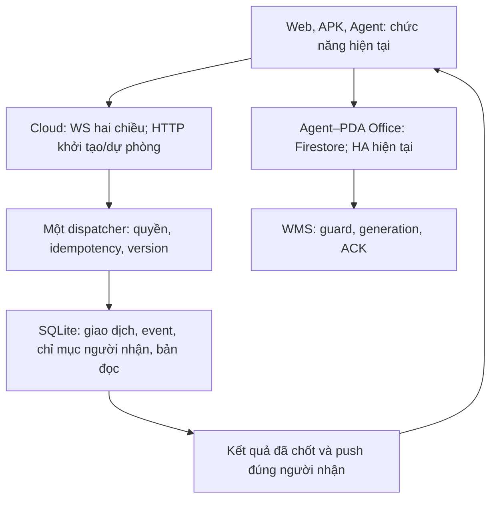

# D173-E107 — Phương án toàn mô hình trong phần bao gồm của gói 5 USD

Ngày: 31/10/2026, Asia/Ho_Chi_Minh. Tiếp tục Draft [PR804](https://github.com/tamnv2/supra-inventory/pull/804), không mở Dxxx mới.

**Trạng thái: OWNER_DIRECTION_RECORDED / ARCHITECTURE_PROPOSED / READONLY_PROVIDER_EVIDENCE. Chưa viết hoặc phát hành kiến trúc mới; chưa có saving, FIELD hoặc OWNER PASS.** E107 thay thứ tự khuyến nghị E106 mà Owner chưa chấp nhận. Các số đo dưới đây là của mô hình đang phát hành; các ngân sách ứng viên là điều kiện kiểm thử, không phải số đo đạt được.

## 1. Đề nghị chốt

Chọn **M2: một bộ xử lý lệnh và sự kiện, WebSocket hai chiều làm đường chính cho Báo hàng, SQLite hiện tại giữ quyền quyết định**. Web, APK và Agent giữ chức năng, giao diện nghiệp vụ, kết quả, quyền, thông số thời gian và quy trình hiện tại. Được đổi logic bên trong để giảm lần đi cloud và đọc lại. HTTP khởi tạo/xác thực/dự phòng dùng cùng bộ xử lý; không tồn tại hai bộ nghiệp vụ khác nhau.

Thiết kế kết hợp ba việc không tách rời: **giảm thao tác thừa; đổi đơn vị request của phần còn lại; giữ tổng từng meter dưới phần bao gồm**. Không cần thêm database/dịch vụ trả phí để bắt đầu. Agent–PDA Office, WMS và HA giữ Firestore/RTDB theo chức năng hiện có; không ép mọi mạng đi Cloudflare.

Owner đã cho phép phân tích lại toàn mô hình và thay logic nếu cần, với kết quả/tốc độ/ổn định giữ nguyên; ngân sách mới là **0 USD phí usage phát sinh ngoài phí Cloudflare nền 5 USD/tháng**, thay dự phòng cộng thêm 5 USD trước đây. Đây là quyền định hướng và lập phương án, không phải Owner chấp nhận chi tiết M2 hoặc lệnh phát hành từ hồ sơ này.

## 2. Nền tảng đã kiểm chứng

Main được đọc lại: `1ccb12a55a3104729881714953735a7654f9231b`. Manifest, bootstrap, scope, quyết định, specs, source và working PR804 đã được đối chiếu. Main không đổi trong lần kiểm tra cuối của audit.

| Thành phần đang phát hành | Căn cứ source/release |
|---|---|
| Web 3.3.2 và APK vc121 | Tag `beta-vc121` tại `e45eafd8fbc69edf6a75c750f61ad9808237394f`; executable source không khác snapshot main. |
| Agent162 | Tag `relay-agent-v162` tại `d7dab62bf482b8a080eb75c8e18ba328e287a7fe`; receipt E104 có tag/channel checksum trùng. |
| Worker/Core E103 | `f15b9675b7de33194dbb43980fd5934ee09958fc`, production run [41002569184](https://github.com/tamnv2/supra-inventory/actions/runs/41002569184) SUCCESS; source không drift với main. |
| Chưa giải quyết | PR803/E105 Agent162 FIELD FAIL về activity/gián đoạn xác nhận; E097 SQLITE_NOMEM chưa có kết luận root cause. Không dùng tối ưu usage để tuyên bố các lỗi này đã sửa. |

E106 đã phân tích 87 log APK của 40 thiết bị, 22 log Agent và ba JSON Web/server khác nhau ngày 30/10. Giữ log/định danh riêng tư ngoài repo public. Counter client là attempt, callback listener không đồng nghĩa billed read; không cộng các snapshot chồng nhau thành tổng cả fleet.

Hai mẫu có ích: Picker có **1.359 GET delta và 4 POST báo hàng**; Reporter có **197 resolve, 263 queue, 262 recent, 260 counters**. Chưa có cause-level trace để gán mọi GET cho một nguyên nhân. Chúng chứng minh đường đọc lại cần xử lý; không chứng minh tỷ lệ tiết kiệm toàn hệ thống.

Hồ sơ E097/E099 ở PR794 chỉ là design/backlog/audit. E107 đọc lại các tài liệu ấy và kiểm source hiện tại; không tái dùng số hop trước E103 như số đang phát hành. D172 độc lập HOLD, shared Worker/Core/Auth vẫn phải hồi quy nếu thay sau này.

## 3. Số thật lấy từ provider, không lấy forecast trên Agent làm hóa đơn

Probe chỉ đọc scope đã đăng ký: Cloudflare billable-usage V1, subscriptions và GraphQL account + Inventory script. Không gọi API nghiệp vụ hay ghi provider. Source probe sửa classifier trước khi lấy bảng cuối: nhận diện rows read/write trước chữ storage, tách đơn vị; không gộp số rows với GB-month.

Nguồn tái kiểm tra: [run41159303687](https://github.com/tamnv2/supra-inventory/actions/runs/41159303687), artifact `d173-e107-budget-readonly`; probe bổ sung [run41159894993](https://github.com/tamnv2/supra-inventory/actions/runs/41159894993). Bảng số được giữ bền trong tài liệu này; artifact nghiên cứu chỉ giữ 7 ngày. Không suy diễn workflow success thành financial PASS.

### 3.1. Chu kỳ thật của tài khoản: 19/10 → 19/11

Subscription trả `2026-10-19T00:00Z` đến `2026-11-19T00:00Z`, tương ứng 07:00 VN, dài 31 ngày. Không dùng tháng lịch 01→31 hoặc rolling30 thay chu kỳ này.

| Meter account-wide | Đã tiêu thụ trong bản ghi trả về | Bao phủ kết thúc, UTC | Phần bao gồm hiện hành | Mức dùng |
|---|---:|---|---:|---:|
| DO Requests | **530.263** | 31/10 00:00, 12 mẫu ngày | 1.000.000/chu kỳ | **53,03%** |
| DO SQLite Rows Read | **4.108.503.415** | 31/10 00:00, 12 mẫu | 25.000.000.000/chu kỳ | 16,43% |
| DO SQLite Rows Written | **1.358.361** | 31/10 00:00, 12 mẫu | 50.000.000/chu kỳ | 2,72% |
| DO Duration | **3.657,155 GB-s** | 31/10 00:00, 12 mẫu | 400.000 GB-s/chu kỳ | 0,91% |
| DO SQL Storage | **0,057057 GB-month** | 30/10 00:00, 11 mẫu | 5 GB-month | 1,14% |
| Worker Requests | **378.638** | 30/10 00:00, 11 mẫu | 10.000.000/chu kỳ | 3,79% |

Mỗi dòng trên có `ContractedCost=0`, `PricingQuantity=0` trong các bản ghi trả về. **Chưa thấy overage ở các dòng/khung này**, không phải chứng nhận hóa đơn cuối cùng, toàn bộ Google/Firebase hoặc dữ liệu chưa đến. Worker CPU V1 trả unit rỗng: không ép số đó thành ms; bảng ngày dưới dùng `cpuTimeUs` có đơn vị rõ. D1 usage nhỏ account-wide không chứng minh Inventory sở hữu/được dùng database đó.

Chu kỳ trước 19/09→19/10 ghi nhận **985.377 DO Requests**, chi phí usage dòng này 0: sát 1 triệu dù các meter khác còn phần bao gồm. Target Cloudflare nội bộ 50% của Inventory vẫn giữ; account-wide 530.263 không được gán hết riêng Inventory, D172 hay Launcher khi chưa attribution.

### 3.2. Ngày đầy đủ 30/10 VN, GraphQL có đủ 24 giờ

| Chỉ số | Số đo ngày | Nếu 31 ngày giống hệt ngày này |
|---|---:|---:|
| DO raw invocation | **41.564** | **1.288.484** raw invocation |
| Trong đó HTTP | **40.672** | 1.260.832 HTTP |
| Hibernation / alarm | 850 / 42 | Không tự coi mọi hibernation event là command |
| DO rows read | **111.673.035** | 3.461.864.085, 13,85% included |
| DO rows written | **148.310** | 4.597.610, 9,20% included |
| DO duration | **503,436 GB-s** | 15.606,502 GB-s, 3,90% included |
| Worker request account / Inventory script | 33.685 / 33.090 | Account 1.044.235, 10,44% included |
| Worker CPU account | 120.245.881 microseconds | 3.727.622,311 ms, 12,43% included |

**HTTP chiếm 97,85% raw invocation.** Account và Inventory-script DO query tình cờ cho cùng tổng ngày; điều này không tách business D172/Launcher vì dùng chung script/Core. Đây là analytics có thể được lấy mẫu, không phải invoice; cột 31 ngày là phép tính điều kiện, không là dự báo hóa đơn. Dataset periodic có inboundWS=0 nhưng Invocations có hibernation; không kết luận không có frame vào dựa riêng inboundWS.

Kết luận có cơ sở: ưu tiên đổi đường HTTP và bỏ đọc lại. Chưa có nhu cầu tài chính để đưa mọi bảng sang D1: read hiện vẫn thấp hơn nhiều phần bao gồm. Bản đọc/tổng hợp có thể dùng thêm writes/CPU/GB-s có kiểm soát để giảm request/scan; các đơn vị không chuyển quota trực tiếp cho nhau.

### 3.3. Phần chưa xác minh

Probe Firestore Monitoring của scope dự án trả **EXISTING_READ_CREDENTIALS_UNAVAILABLE**; không in credential, không đổi quyền, không tạo service account. Không biến thiếu dữ liệu thành 0. Chưa có invoice Google toàn tài khoản, default-database/free-tier eligibility, Cloud Run/Functions CPU/network/storage/RTDB/Drive dung lượng cùng kỳ và attribution đầy đủ các project dùng chung. Dùng collector Usage đã có khi có dữ liệu được ủy quyền; không tạo poller mới.

Vì vậy chưa thể tuyên bố toàn mô hình đã đạt tổng 5 USD. M2 không đẩy thêm tải Báo hàng sang Firebase để che DO request; kiểm kê và kiểm chứng các meter còn thiếu là financial gate trước rollout, không đợi hóa đơn phát sinh mới xét.

## 4. Kiến trúc đề nghị M2

Sơ đồ mô tả ranh giới; không tạo thêm DO trung gian. FCM đánh thức nền, Drive lưu log, RTDB liveness và các API Google giữ đúng chức năng, không bị biến thành nguồn giao dịch Báo hàng.

### 4.1. Một lệnh, một lần quyết định, một kết quả chuẩn

Envelope có protocol version, command/request ID, operation, expected entity version và view watermark. UID/role/device/session generation được server suy ra từ phiên đã xác thực, không tin identity client tự khai. Worker kiểm chứng ingress Firebase như hiện tại khi bắt tay; Core kiểm **live** session/revocation/capability, expiry, ngày làm việc và quyền trên mỗi command. Hibernation phục hồi attachment tối thiểu; không persist/log token, refresh secret hoặc tin role cache quá hạn.

HTTP và WS gọi cùng dispatcher bằng lời gọi hàm nội bộ, **không `stub.fetch()` quay lại chính DO cho từng message**. SQLite transaction chốt business state, event/audience index, request-id result và read projection trước khi public success. Hai lần gửi cùng request ID qua WS→HTTP sau mất ACK trả cùng canonical result, không tạo ticket/resolve/receipt lần hai. Request ID khác nhưng xung đột entity dùng CAS/version và nghiệp vụ hiện hành, không tự merge kết quả.

Không tạo durable offline mutation queue. Khi mạng mất, không báo thành công giả; local pending chỉ phục vụ thao tác đang online và truy vấn lại kết quả theo ID. Khi chưa biết commit đã xảy ra, UI reconcile ID trước khi cho gửi một nghiệp vụ mới. Log hay bản đọc local không trở thành authority.

### 4.2. Màn hình sống bằng kết quả và sự kiện, không tải lại sau mỗi event

Reporter bootstrap nhận queue + trang recent + counters + SLA/clock + overdue khi view đang mở trong một snapshot/watermark. Picker nhận report/result/window/capability tương ứng. Snapshot bounded theo page/filter, không nạp cả lịch sử/nhân sự vào PDA.

Command trả public patch đủ cho màn hình và event identity. Socket push cùng event cho các người nhận khác. Web/APK dùng cùng reducer, dedupe event/request ID, chỉ áp dụng version tăng; response cũ không ghi đè state mới. Không phát thêm ba GET queue/recent/counters sau resolve thành công khi patch đầy đủ. Auth/profile/meal có thể gộp ở lần khởi tạo/resume thích hợp nhưng không bỏ revocation hay quy tắc một người nghỉ ăn thắng.

Một snapshot hợp nhất không được gọi các endpoint cũ bên trong; phải query trực tiếp trong cùng DO. Màn hình thay filter/page hoặc reconnect cần dữ liệu thật mới lấy trang cần thiết. Các view có cùng quyền/filter có thể dùng cùng phép tính trong một invocation; không chia payload nhạy cảm qua user khác.

### 4.3. Chỉ đọc bù khi thực sự thiếu sự kiện

Hiện client so khoảng trống global sequence trong khi server lọc theo người nhận. Sự kiện của người khác có thể tạo khoảng trống nhìn giống mất gói. Server delta lại đọc tối đa 100 global events, kiểm recipient và dựng projection. Chỉ xóa `seq > applied+1` sẽ làm mất bảo vệ và không được làm.

Đề nghị audience index/sequence hoặc coverage token bền, được ghi cùng transaction event. Envelope gắn stream epoch, session generation, view revision và covered-through cursor. Index giới hạn đúng actor/role/tenant theo quyền, không tạo fan-out một bản sao full payload cho mọi session. Reconnect lấy đúng phần audience chưa nhận qua WS hoặc HTTP cùng handler; retention/epoch/filter thay thật thì snapshot bounded. Session thay/disable phải ngừng stream cũ; tombstone/thu hồi là dữ liệu bắt buộc.

Thông điệp không được dồn chờ gom lô làm chậm xử lý. Tận dụng response/event đã tồn tại để piggyback cursor, clock và metadata có cùng ranh giới quyền. Không gửi ACK-cho-ACK hoặc JSON heartbeat không cần thiết. Protocol ping OkHttp 20 giây hiện có không phải HTTP poll hoặc app command tính phí.

### 4.4. Dùng thêm ghi/tính toán để đọc ít đi, có chặn ngân sách

Mở rộng `batch_summaries`/read model đang có, không tạo lại tính năng đã làm ở E055. Cập nhật count/recipient/overdue projection khi state thay đổi, cùng transaction; snapshot đọc theo index/page thay scan và query từng recipient. Khoảng ngày tùy ý phải có phép gộp đúng, không chỉ tối ưu nguyên ngày rồi sai biên. Có version và rebuild/reconcile từ authority khi projection thiếu hoặc restart; RAM chỉ là cache bounded và có thể bỏ.

Ví dụ minh họa, không phải số đo database thật: 1.000 lượt xem cùng 10.000 dòng bằng full scan là 10 triệu rows; một lần duy trì summary rồi 1.000 lần đọc vài dòng có thể giảm nhiều rows, đổi lấy writes/index/CPU. Cần đo `rowsRead/rowsWritten` thật của query, trigger, index, telemetry; SELECT ít cột hoặc trả ít dòng chưa chứng minh scan ít. `storage.get()` trên SQLite cũng không miễn rows.

E049 counter bền sau crash phải giữ. Bỏ invocation/query dư tự giảm counter-write liên quan; không thay bằng RAM lossy để làm usage đẹp. CPU xử lý JSON/hash/nén/redaction thích hợp ở Worker/client; business auth/transaction vẫn Core. Không kéo một DO thức liên tục để tránh request: phải dùng Hibernation API, kết thúc handler, không `setInterval` giữ object sống.

### 4.5. Notification, tác vụ nền và Agent cùng tham gia ngân sách

Mutation hiện đã auth+operation, broadcast và chuẩn bị FCM trong một invocation. Không tính đó là tiết kiệm mới. Phần còn lại là delivery-attempt callback và optional disable-token có thể tạo DO HTTP. Với WS dispatcher, hàm FCM phía server có thể gửi sau commit rồi ghi attempt/disable trực tiếp trong chính Core lifecycle, không self-fetch; public result không mang FCM token và không đợi external send mới thành công. Cần tách lời gọi FCM khỏi SQL transaction, timeout/retry bounded và đo GB-s. Nếu lifetime/durability không giữ đúng receipt hiện có, giữ callback và tính vào H; không bỏ receipt để đạt số đẹp.

Giữ DISPLAYED, wake lock/overlay, thứ tự terminal và retry notification như hiện tại. Gộp callback cùng kết quả khi thật sự cùng thời điểm; không tạo Queue/alarm/DO mới cho mỗi message hoặc trì hoãn cảnh báo để gom.

Cron vẫn 5 phút. Retired HR retry đọc status một lần/tick có thể bỏ theo đúng điều kiện intake đã retire (tối đa lịch chuẩn 288 DO/ngày); log pending và các maintenance due còn giá trị có thể gộp một plan read. D172 drain giữ nguyên và phải dự trù. Launcher folder cache6h đã có; không đếm thành mỗi tick đều cold lookup. Agent log drain và audit export dùng Firestore/Drive, không đổi tên thành DO reads. Lịch log13:15/21:15, SLA, closed-day, launcher và retry không chậm đi.

Agent cloud metadata/roster/SKU/Usage có thể mang chung metadata khi cùng phiên/quyền/cadence. SKU snapshot versioned + chunk bounded + manifest/checksum để bớt info trùng; không tăng page lớn gây hết RAM hoặc bỏ kiểm generation trước commit. Usage collector hiện đã cache/batch, không phải 36 metric=36 DO calls; local timer vẽ CPU/RAM không phải cloud poll.

### 4.6. Agent–PDA/WMS: giữ carrier, sửa tác vụ thừa nếu có bằng chứng

Không đổi Firestore job/ACK carrier, Office proxy/profile fallback, generation/fencing, WMS guard, PRIMARY lease heartbeat10s/stale15s, thời gian UI20s/recovery35s đúng grant, HA mục tiêu<20s và phản hồi nghiệp vụ<5s hiện hành. Không ép WebSocket Internet thay đường Office đã hoạt động.

Các sửa logic trong cùng mô hình có thể giảm usage lỗi và tăng ổn định: tách WMS outcome khỏi exception giao ACK; một ngân sách retry theo logical job thay retry lồng tầng; dùng canonical ACK thắng CAS cho history/count; listener/session generation hủy đúng vòng đời; cache lock invalidate khi generation đổi. E099 đã nêu `3 commit × 3 verify read` có thể thành9 GET trong chuỗi lỗi; **không phải mọi job đều có9 GET**. Không bỏ verify cần thiết hoặc đánh đổi timeout/guard để tiết kiệm. Sau final click không chắc kết quả chỉ đọc/giao lại proof, không bấm WMS lần nữa.

Các nhánh này phải rebase trên E105 investigation và source hiện tại trước khi code; E107 không tuyên bố đã chứng minh root cause của gián đoạn Agent162. Firestore happy path không tăng operations do thiết kế Báo hàng mới; phép sửa có thể thêm ít authoritative read lúc HA nếu cần đúng kết quả, phải đo tổng ngân sách.

## 5. Vì sao đổi được loại usage và ví dụ dễ hiểu

Cloudflare tính 1 HTTP/RPC invocation khoảng1 DO compute request; **20 incoming WebSocket application messages tương đương1 billed request**. Outgoing WS và protocol pings không tính request. Handshake vẫn1 request, duration và SQL vẫn tính riêng. Raw dashboard không áp dụng20:1. Worker tính initial WS Upgrade, không tính từng message đi qua như một Worker request. Quy tắc kiểm tra31/10/2026 tại [DO pricing](https://developers.cloudflare.com/durable-objects/platform/pricing/) và [Worker pricing](https://developers.cloudflare.com/workers/platform/pricing/).

Ví dụ **100 lần Reporter xử lý**, chỉ xét nhánh mã `resolve → queue → recent → counters`, không phải toàn ca:

| Cách xử lý | DO raw trên nhánh này | DO billed compute request tương đương |
|---|---:|---:|
| Hiện tại, 100 resolve + 300 refresh HTTP | 400 | khoảng400 |
| M2, 100 command WS và100 kết quả push/public patch | 100 incoming messages | khoảng5, cộng handshake và hoạt động phụ cần thiết |

Raw giảm75% ở nhánh minh họa; billed phần nhánh đó giảm98,75% trước overhead. Không nói toàn mô hình giảm98,75%, không cộng hai phần trăm với nhau. FCM callback, DISPLAYED, auth, recovery, D172, background có ngân sách riêng. Nếu client offline/background không giữ socket, FCM/HTTP vẫn hoạt động và được tính; không giả định socket luôn sống.

Đây là đổi cách làm việc để tận dụng phần bao gồm về message/CPU/duration/writes; **không chuyển 1 tỷ quota rows thành quota requests**. WS tự nó không giảm SQL của mỗi command. Bản đọc/sự kiện và bỏ refresh mới giảm scan/CPU/telemetry tiếp theo.

## 6. Ngân sách thiết kế và điều kiện không phát sinh usage fee

Các hạn mức Paid tại ngày audit: DO1M compute requests,400kGB-s,25B reads,50M writes,5GB-month; Worker10M requests,30M CPU-ms. Target Inventory50% đã duyệt vẫn là trần phân bổ nội bộ, không là lời hứa hóa đơn. Đề xuất release gate thấp hơn một phần trần để có dự phòng lỗi/reconnect.

| Meter | Gate ứng viên cho một chu kỳ31 ngày | Tỷ lệ included account | Dữ liệu sau khi code phải chứng minh |
|---|---:|---:|---|
| DO billed compute requests | **≤450.000** |45%| H và M thực, old-client/fallback, retry, shared scope |
| DO rows read | **≤10 tỷ** |40%| query+trigger+auth+diagnostics+recovery, có scan đo thật |
| DO rows written | **≤20 triệu** |40%| event/index/summary/idempotency/telemetry/alarm/retention |
| DO duration | **≤100.000 GB-s** |25%| cả external I/O, reconnect, nền và Hibernation |
| DO SQL storage | **≤2 GB-month** |40%| stock và retention, không dùng số GB-month làm GB hiện tại |
| Worker requests / CPU | **≤4 triệu /12 triệu ms** |40%/40%| account và script riêng, đơn vị chuẩn |
| Workers Logs | **≤8 triệu events** |40% của20M hiện hành| sampling/retention giữ chẩn đoán, xác minh lại giá từ01/12/2026 |

Đây là **giới hạn nghiệm thu đề nghị**, chưa phải forecast có đủ evidence của M2. Included quota là account-wide: chỉ đạt tài chính khi tổng các project và phần dự phòng cùng meter vẫn≤included. Không lấy một meter dư bù meter khác. Không tự sử dụng quota hoặc database project khác.

Đặt H = tổng invocation cần tính1:1 mỗi ngày: HTTP/RPC/auth/handshake, fallback, cron/alarm, log/SKU/FCM callback và tải dùng chung nằm trong scope đo; close/error hoặc mục chưa rõ tính bảo thủ vào H. M = **mọi incoming app message**, bao gồm receipt/control/retry, không chỉ giao dịch người dùng.

Ngân sách bảo thủ31 ngày: `B = 31 × (H + ceil(M/20))`. Raw gần `31 × (H+M)`; đây là hai chỉ số khác nhau. Rounding ngày bảo thủ cho planning, không giả định invoice làm tròn theo từng ngày.

| Kịch bản kiểm thử đề nghị | H/ngày | M/ngày | Raw31ngày | Billed tương đương31ngày |
|---|---:|---:|---:|---:|
| Tải thiết kế |8.000|10.000|558.000|**263.500**,26,35% included |
| Stress message gấp 10 lần |8.000|100.000|3.348.000|**403.000**,40,30% included |

8.000H/ngày là mục tiêu cần chứng minh bằng loại duplicateHTTP, chuyển command/read/recovery phù hợp sang WS và gộp maintenance; chưa có route attribution đầy đủ để khẳng định chắc chắn đã đạt. Những20:1 message không được cộng lại vào H. Nếu D172/Launcher/auth/WS-bị-chặn/old-client tạo floor vượt8.000 thì bảng này **không PASS**; phải tối ưu lại hoặc báo giới hạn tải thực tế, không cắt giao dịch hay giảm chất lượng để ép số.

Giới hạn duration100k không được xem như vô hạn: một object128MB bị giữ thức liên tục31ngày khoảng342.835GB-s theo cách quy đổi ví dụ provider, gần hết400k account trước các object khác. Do đó hibernation và external I/O bounded là điều kiện tài chính, không chỉ kỹ thuật.

Ở timestamp billing mới nhất, còn **469.737** DO request included, còn20ngày đến19/11. Nếu lập tức giữ được stress13.000 billed-equivalent/ngày, tổng điều kiện là `530263 +20×13000 =790263`; tải thiết kế8.500/ngày cho700.263. **Không phải cam kết ứng viên kịp phát hành hoặc dự báo hóa đơn**. Ngày tiếp tục mô hình cũ, dữ liệu billing đến trễ, tải khác account và cohort rollback đều phải cộng. Không dùng lời hứa saving tương lai để duyệt phí ngoài gói chu kỳ này.

Firestore/free Google cần gate riêng: Standard default database đủ điều kiện hiện có50k document reads,20k writes,20k deletes/ngày theo Pacific,1GiB stored và10GiB outbound/tháng; không chia theo tháng VN hoặc bù ngày. Chưa xác minh live thì hiển thịN/A, không đánh dấu tài chính xanh. RTDB, Functions/Cloud Run, Auth/FCM consumed APIs, Drive/Apps Script/Email, GitHub artifacts/actions cần kiểm meter phù hợp nguồn hiện có, storage/retention/API limits tách nhau; không giả định mọi thứ mang nhãn Google/Firebase là free. M2 không thêm Queue/KV/D1 hoặc collector trả phí và không thay carrier Office.

**Phạm vi bảo đảm hợp lý:** mục tiêu0 overage trong tải thiết kế đã đo và tổng account đã kiểm. Không thể bảo đảm vừa không giới hạn traffic/lỗi/other-project, vừa phí chính xác5USD, vừa không bao giờ ngắt dịch vụ. Phí nền không tự là billing cap. Cloudflare có Spend Policies `notification`/`usage_block` cho Workers/DO; minimum threshold1cent và enforcement bất đồng bộ. `usage_block` có thể dừng sản phẩm đến hết kỳ, trái yêu cầu giữ hoạt động; không bật tự động hoặc dùng nó làm bằng chứng hard cap0USD. Budget alert là thông báo, không chặn hóa đơn. Thuế/FX không phải usage thiết kế.

## 7. So sánh các lựa chọn

| Lựa chọn | Request/rows | Kết quả và rủi ro | Quyết định đề nghị |
|---|---|---|---|
| M0 giữ nguyên/đo | Có số provider thật nhưng HTTP97,85%; chu kỳ cũ985k/1M | Ít migration; không tạo headroom mới | Giữ làm baseline, không phải lời giải |
| M1 chỉ gộpHTTP/bỏ refresh | Giảm invocation/scan thật; request còn lại vẫn1:1 | Ít protocol risk nhưng chưa chứng minh có dự phòng toàn account | Thành phần củaM2, không giới hạn phương án ở đây |
| **M2 WS hai chiều + kết quả/event + bản đọc cùng SQLite** | Loại đọc dư,20:1 message billing; thêm writes/CPU/duration có gate | Đổi protocol/recovery nhưng giữ authority/transaction và HTTP rollback | **Chọn làm candidate toàn mô hình** |
| M3 đưa live authority/read sangD1 | Có thể đổi một phần hop/read meter; auth cònDO chưa chắc bỏrequest | Không có binding Inventory hiện tại; distributed atomicity, migration/lag/rollback; scan vẫn tính | Không cần cho vấn đề request trước mắt. D1 chỉ xem lại cho SKU/lịch sử versioned khi có bằng chứng và resource approval |

Không lựa chọn poll chậm, kéo heartbeat/deadline, TTL quyền để bỏ revocation, bỏ DISPLAYED/FCM/ACK, bỏ log bền, websocket gateway gọi lại DO qua HTTP, hoặc gom mọi kết nối Office vào một transport không đi được mạng đó.

## 8. Ma trận yêu cầu → thành phần → hợp đồng → kiểm chứng

| Yêu cầu | Thành phần/hợp đồng bị ảnh hưởng | Kiểm thử và evidence bắt buộc trước rollout |
|---|---|---|
| Cùng kết quả giao dịch | Core dispatcher, SQLite, Web/APK reducer | Replay cùng chuỗi input baseline/candidate; create/withdraw/resolve/correct/meal/auto-skip/DISPLAYED; exact business fields, order/filter/counters/versions; concurrent winner; rollback/restart. Chỉ loại nondeterministic transport metadata khi so. |
| Không lặp khi đứt mạng | WS/HTTP, request ID, entity CAS | Commit xong mất response; message lặp/đảo thứ tự; HTTP fallback cùng ID; socket đóng giữa transaction; process restart; query canonical result trước thao tác mới; không có offline business queue. |
| Không lộ dữ liệu hoặc phiên cũ | Firebase ingress, Core live RBAC, attachment | Kick/replace/disable/đổi role/token hết hạn giữa các WS message; resume sau hibernation; khác quyền view; phiên cũ nhận frame; không token trong log/frame/báo cáo public. |
| Realtime không mất/chậm | Audience index, epoch, view revision, retention | Event của người khác không gây đọc bù; thiếu event thật được bù; tombstone; seq reset; snapshot/delta race; biên ngày và mốc 00/03/05/06/22 giờ, clock skew. |
| Snapshot/summary đúng | Triggers, read models, paging/SKU | >200 rows, khoảng ngày tùy ý, summary thiếu/rebuild, chunk/RAM PDA, full/delta catalog generation, checksum; cache eviction không đổi kết quả. |
| Notification vẫn đủ | FCM delivery/attempt/disable, DISPLAYED | Send timeout/token invalid, app background/locked, mạng chập chờn; terminal trước ACTIVE; overlay trùng; không alarm riêng mỗi message; receipt/counter bền sau crash. |
| Agent/PDA/WMS/HA giữ chất lượng | PRIMARY/generation/guard, Firestore, RTDB | Office/Internet/gRPC bị chặn/RTDB timeout; đổi lease khi confirm; WMS thành công nhưng ACK lỗi; không bấm lần hai; canonical ACK; stream hết phiên; activity FIELD FAIL không tự coi đã sửa. |
| D172 và hệ thống dùng chung | Shared Worker/Core/Auth/schema | D172 independent API/auth/SQLite/source isolation guards PASS; nghiệp vụ/Sheet/APK/channel riêng D172 không đổi; SQLITE_NOMEM startup/recovery có evidence riêng. |
| Không tăng latency/lỗi/tài nguyên | Web/APK/Agent/Worker, network | Cùng fleet/PDA-hours/transaction mix, p50/p95/p99 từ action→durable→display, lỗi/timeout/duplicate; happy path và recovery không tệ hơn baseline ngoài nhiễu giải thích; giữ <5 giây nghiệp vụ/<20 giây HA và mọi timeout hiện hành. Đo CPU/RAM/pin PDA/frame burst/backpressure. |
| Không phát sinh overage | Mọi meter/account/billing window | H/M/bytes/SQL writes/duration/logs/provider usage cùng window; chuẩn hóa trên 1.000 logical operations; cộng carryover chu kỳ hiện tại, client cũ, rollout và rollback. Thiếu dữ liệu hoặc lẫn scope không PASS. |

Baseline local có ba fixture hiện hữu PASS ở E106: `realtime_cursor_regression.py`, `d173_e055_usage_regression.py`, `d173_e049_sqlite_fixture.py`. Không dùng chúng để chứng nhận code M2 chưa viết. Probe E107 có offline parser/boundary selftests và public-secret guard, không tạo tác vụ provider lặp trong production.

## 9. Cách thực hiện và quay lại an toàn

1. Chốt M2 cùng phạm vi/financial gates; lập candidate trong D173 trên latest main, reconcile PR803/E105. Chưa deploy. Lưu yêu cầu, component, contract, test trước khi sửa runtime.
2. Tách dispatcher HTTP hiện tại và thêm protocol WS theo capability; SQLite migration/index/read model bổ sung có version, backfill giới hạn và kiểm thử bộ nhớ lúc startup. Không tạo object v2/database clone mất atomicity; không chạy hai mutation để so sánh. Read-only differential replay dùng fixture đã ẩn định danh.
3. Cập nhật Web/APK/Agent phần bị ảnh hưởng; UI/flow/ký/package/channel và network policy giữ hiện có. Có HTTP fallback cùng ID; session/capability negotiation. Mọi client cũ hoặc fallback được tính trong budget. Không giữ vô hạn hai đường cùng tải.
4. Kiểm traffic thực tế và fault/load test trong nguồn hiện có, không tăng tải production thật để benchmark. Giả định ban đầu 60 PDA đồng thời/150 sessions ngày/6 Agent/10 Web tabs là **đề xuất bộ test**, không phải số fleet đã xác nhận. Bắt buộc thêm 2×client-hours ca thật, burst20 PDA/5 giây, M100k/ngày, socket bị chặn cả ca, auth/reconnect storm, standby takeover và fallback100%.
5. Chỉ rollout theo phiên bản/capability sau exact-source CI, D172 regression và source-pinned release authorization. Lấy ít nhất hai ca tải so được, mixed network, rồi theo dõi ít nhất ba ngày hoạt động và chu kỳ billing để phân biệt field/financial evidence; không đợi đủ chu kỳ mới phát hiện vượt pace. Candidate kém latency/correctness thì rollback protocol cùng authority, giữ event/idempotency bổ sung và signed channels hiện có.
6. Rollback/tải cũ tiêu request nhiều hơn: tính cả dự phòng và báo nguy cơ ngân sách. Không tự nâng gói, block business, giảm deadline hay tắt tính năng để giữ5USD. Nếu gate không đạt, candidate chưa đủ điều kiện phát hành; tiếp tục tối ưu trong D173.

**Cụ thể để Owner duyệt:** kiến trúc M2; scope Core/Worker+Web/APK+Agent cloud adapter/recovery logic cần thiết; không thêm paid resource/D1; giữ UI/nghiệp vụ/các thông số hiện có; 0USD overage là financial gate trên tải đã xác minh; việc code và release cần xác định ở lệnh tiếp theo. Đây là bản đề xuất, không phải cập nhật production.

## 10. Chỉ dẫn source và tài liệu gốc

- Hotpath/WS/lifecycle: `service/src/core.ts` (webSocketMessage, authorizedroutes, Hibernation); `service/src/business-api.ts` (preparedFCM, deliveryattempt callback); `service/src/index.ts` (authrefresh/maintenance/AgentSKU).
- SQL/realtime: `service/src/operational-v2-core.ts` (summary,counters,recipientprojection,delta); `service/src/read-model-core.ts`; `service/src/d173-persistent-usage.ts`; `service/src/sla-automation.ts`.
- Clients: `web/src/realtime-client.ts`, `web/src/operational-app.ts`; Android `ReporterController.kt`, `PickerController.kt`, `AndroidRealtimeClient.kt`, `MainActivity.kt`, `SkuCatalogCache.kt`; Agent `D173VpsUsage.cs`, `D173ReporterPresence.cs`, `D167SkuServiceClient.cs`.
- Agent–PDA: `FirestoreConfirmationTransport.cs`, `D160ConfirmPipeline.cs`, `FirestoreD157Realtime.cs`, `FirestoreHttpTransport.cs`, `FirestoreAgentLeaderCoordinator.cs`, `RtdbHaLiveness.cs`, `FirestorePickerRateLimiter.cs`; E099/PR794 là backlog, E105/PR803 là field investigation chưa đóng.
- [Cloudflare DO pricing](https://developers.cloudflare.com/durable-objects/platform/pricing/), [metrics](https://developers.cloudflare.com/durable-objects/observability/metrics/), [WebSocket Hibernation](https://developers.cloudflare.com/durable-objects/best-practices/websockets/), [Workers pricing](https://developers.cloudflare.com/workers/platform/pricing/), [D1 pricing](https://developers.cloudflare.com/d1/platform/pricing/).
- [Cloudflare billable usage](https://developers.cloudflare.com/billing/billable-usage/), [API BillableUsage V1](https://developers.cloudflare.com/api/typescript/resources/billing/subresources/usage/), [API Spend Policies](https://developers.cloudflare.com/api/resources/billing/subresources/spend_policies/), [budget alerts](https://developers.cloudflare.com/billing/budget-alerts/). API schema checked on audit date; a documentation URL alone does not prove policy enabled on account.
- [Firestore free quota](https://firebase.google.com/docs/firestore/quotas), [Google Cloud budgets](https://cloud.google.com/billing/docs/how-to/budgets). No Firebase financial PASS inferred from Cloudflare evidence.

Runtime/business source, signed builds, provider databases/Rules/Routes/plans/resources unchanged by this checkpoint. The only executable additions are bounded offline/CI read-only research probes on the draft branch. D172 independent HOLD; historical Stable OWNER-GATED; D173/E105 remain open.
